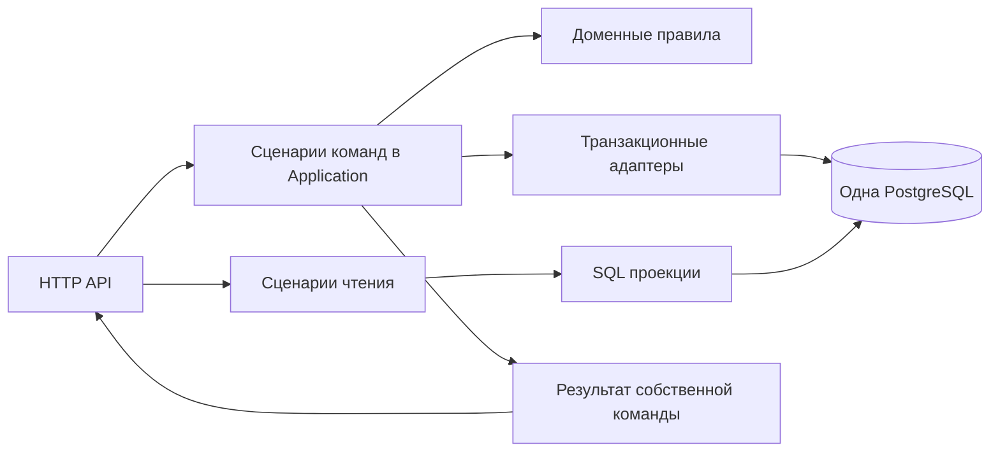

# Глубокое ревью бэкенда Blog Engine

Дата: 27 октября 2026 года. Проверенный commit: `79586dff6b6f3a8ce17328b7b2d1337c408d5daf`.

## Основной вывод

Бэкенд имеет разумную основу для MVP: независимый Core, отдельные HTTP и Operator hosts, ограничения PostgreSQL, явные версии ресурсов, атомарные изменения реакций и достаточно содержательные тесты конкурентных операций. Переписывать систему целиком оснований нет.

Основные проблемы находятся на границах транзакций, в стоимости записи и эксплуатационной диагностике. Особенно важны повторное чтение после уже подтвержденного сохранения, загрузка полного Markdown при лайках и просмотрах, а также жестко ограниченная скорость очистки дедупликации. Есть и пробел в доказательстве совместимости OpenAPI: часть проверки сравнивает нормативный контракт с его же копией.

**CQRS в пределах одного приложения и одной PostgreSQL здесь уместен и уже частично реализован.** Следующий полезный шаг — самостоятельные сценарии Application, явные результаты команд и более узкие модели доступа к данным. Брокер, Event Sourcing и отдельная база чтения пока не обоснованы. Они добавят вопросы доставки и согласованности, а существующие проблемы автоматически не устранят.

**Будущие логи, трейсы и метрики не требуют CQRS.** Их можно подключить через стандартные средства .NET и OpenTelemetry. Разделение сценариев на обработчики помогает единообразно измерять операции, но само по себе не является условием наблюдаемости. Подробная схема приведена ниже.

## Область и достоверность проверки

Рассмотрены четыре production-проекта: `BlogEngine.Core`, `BlogEngine.Infrastructure`, `BlogEngine.Api`, `BlogEngine.Operator`; доменные правила, запросы, транзакционные store, JWT/JWKS, visitor tokens, очистка, миграции, grants, Dockerfile, CI, эксплуатационная документация и существенные тестовые сценарии. Требования сопоставлены со спецификацией MVP и конституцией проекта. Frontend, прототипы и исходники внешнего Identity в область этого ревью не входят.

Это ревью исходников с доступными локальными проверками, а не аудит работающей production-инсталляции. В частности, не проверялись реальные ingress, резервное восстановление, сетевые политики и актуальная база CVE всех зависимостей.

В отчете используются три уровня доказательства:

- **Воспроизведено** — выполнена проверка реального компонента или существующий тест, подтверждающий описанное поведение.
- **Подтверждено кодом** — последовательность операций однозначно видна в исходниках; указан сценарий для регрессионного теста. Гонки PostgreSQL в этой сессии не воспроизводились.
- **Риск или рекомендация** — последствия зависят от нагрузки, окружения или будущего развития. Это не утверждение о произошедшем инциденте.

Приоритеты: **P1** — исправить в первую очередь; **P2** — запланировать исправление; **P3** — небольшое контрактное несоответствие. Для проблем производительности P1 означает приоритет перед ростом публичной нагрузки, а не доказанный провал текущего MVP. Оснований заявлять критическую уязвимость уровня P0 по результатам проверки нет.

### Что фактически проверено

| Проверка | Результат |
| --- | --- |
| Release-сборка решения с `--no-restore -warnaserror` | Успешно, 0 предупреждений и 0 ошибок |
| Unit tests | 82 пройдено, 0 ошибок, 0 пропусков |
| HTTP и Authentication integration tests без PostgreSQL | 17 пройдено после отключения недоступного Windows EventLog provider |
| OpenAPI compatibility tests без PostgreSQL | 2 пройдено; пределы этих тестов разобраны в F06 |
| Дополнительные локальные probes | Подтвердили F04, F06 и F10 |
| PostgreSQL integration и concurrency suite | Не запускался: Docker Linux Engine недоступен |
| Нагрузочный профиль SC-005 | Не запускался; его перенос уже согласован владельцем для текущего MVP |

Первый запуск выбранных HTTP/auth-тестов дал 15 успешных и 2 ошибочных результата из-за отказа доступа к Windows EventLog `.NET Runtime`. Повтор выполнен с `Logging__EventLog__LogLevel__Default=None` в окружении отдельного процесса. Production-код для этого не менялся. Это ограничение локального окружения, а не подтвержденная ошибка Linux-развертывания.

Суммарно прошли 101 различная проверка существующего набора: 82 unit и 19 выбранных integration tests. Этот результат не заменяет полный прогон с PostgreSQL.

Локальные доказательства:

- [Результат сборки](D:/Space/Personal/blog/artifacts/reviews/2026-10-27/build.txt).
- [Unit TRX](D:/Space/Personal/blog/artifacts/reviews/2026-10-27/test-results/backend-review-unit.trx).
- [HTTP и JWT TRX](D:/Space/Personal/blog/artifacts/reviews/2026-10-27/test-results/backend-review-http-auth-no-eventlog.trx).
- [OpenAPI TRX](D:/Space/Personal/blog/artifacts/reviews/2026-10-27/test-results/backend-review-openapi.trx).
- [Результаты дополнительных probes](D:/Space/Personal/blog/artifacts/reviews/2026-10-27/probe-results.json) и [их исходник](D:/Space/Personal/blog/artifacts/reviews/2026-10-27/probes/Program.cs).

`artifacts/` исключен из Git. Отчет содержит необходимые сценарии и выводы независимо от сохранности этих локальных файлов.

## Реестр замечаний

| ID | Приоритет | Проблема | Доказательство |
| --- | --- | --- | --- |
| F01 | P1 | Ошибка или чужая версия в ответе после успешного commit публикации | Код, сценарий гонки |
| F02 | P1 перед ростом нагрузки | Лайки, просмотры и комментарии загружают полный Markdown под общей блокировкой | Код; задержки не измерены |
| F03 | P1 перед ростом нагрузки | Очистка удаляет максимум 48 000 строк в сутки на реплику | Код и расчет |
| F04 | P2 | Короткий TTL JWKS создает периодические отказы при исправном Identity | Воспроизведено |
| F05 | P2 | Один DTO собирается из разных снимков данных | Код, сценарий гонки |
| F06 | P2 | Проверка OpenAPI может пропустить изменение реальных DTO и binding | Воспроизведено на transformer |
| F07 | P2 | Readiness не обнаруживает отсутствующую или несовместимую схему | Код |
| F08 | P2 | Полная буферизация каждого JSON body усиливает расход памяти | Код; нагрузка не измерена |
| F09 | P2 | Безопасные логи недостаточны для локализации ошибок и задержек | Код |
| F10 | P3 | Проверка Accept непоследовательно учитывает тип успешного ответа и q | Воспроизведено |

## Детальные замечания

### F01 Ошибка ответа после успешного сохранения публикации

**P1. Подтверждено кодом.**

В [PublicationCommandEndpoints.cs:17](D:/Space/Personal/blog/src/BlogEngine.Api/Endpoints/PublicationCommandEndpoints.cs:17) команда создания сначала полностью завершается, затем выполняется `WorkspaceQueries.GetAsync`. Такой же порядок используется при редактировании и переходах publish/unpublish: [строка 23](D:/Space/Personal/blog/src/BlogEngine.Api/Endpoints/PublicationCommandEndpoints.cs:23) и [строка 38](D:/Space/Personal/blog/src/BlogEngine.Api/Endpoints/PublicationCommandEndpoints.cs:38). Commit уже выполнен в [PublicationStore.cs:22](D:/Space/Personal/blog/src/BlogEngine.Infrastructure/Persistence/Publishing/PublicationStore.cs:22) или [PublicationWriteScope.cs:22](D:/Space/Personal/blog/src/BlogEngine.Infrastructure/Persistence/Publishing/PublicationWriteScope.cs:22).

Из этого следуют два наблюдаемых клиентом сценария:

1. Команда успешно записала материал, после чего соединение с БД стало недоступно. Дополнительный GET выбрасывает исключение, и клиент получает ошибку, хотя изменение уже сохранено. Повтор создания с тем же slug затем даст конфликт.
2. Между commit и GET другой разрешенный редактор изменил или удалил материал. Первый запрос возвращает уже чужую следующую версию либо 404 вместо результата собственной успешной команды.

Это не проблема атомарности самой записи: транзакция сохраняется корректно. Проблема в том, что подтвержденный результат записи зависит от последующей независимой операции чтения. Особенно неудачно это для интерфейса редактора: он не может надежно понять, сохранился ли материал.

**Исправление.** Команда должна сформировать неизменяемый результат внутри своей транзакционной области, подтвердить commit и вернуть уже подготовленный snapshot. API только преобразует результат в DTO. Альтернатива — вернуть идентификатор и версию с отдельным явно независимым чтением, но это потребует согласованного изменения HTTP-контракта. Сохранение текущего DTO без дополнительных чтений после commit предпочтительнее.

Полностью исключить неопределенность при потере HTTP-ответа невозможно. Для create при необходимости надежных автоматических повторов отдельно потребуется клиентский ключ идемпотентности. Это не повод оставлять дополнительное окно ошибки после уже известного успешного commit.

**Проверка исправления.** Остановить запрос сразу после commit, выполнить конкурентное удаление или изменение и продолжить формирование ответа. Первый запрос должен вернуть результат своей команды. Отдельно смоделировать недоступность БД после commit: для подготовки ответа новое обращение к БД не требуется.

### F02 Дорогой общий путь записи для действий над публикацией

**P1 перед ростом нагрузки. Подтверждено кодом; влияние на p95 и throughput не измерено.**

[PublicationWriteScope.cs:15](D:/Space/Personal/blog/src/BlogEngine.Infrastructure/Persistence/Publishing/PublicationWriteScope.cs:15) выполняет `SELECT * ... FOR UPDATE`, материализует `Publication` целиком, затем безусловно делает `ReloadAsync`. В сущность входит Markdown размером до 1 MiB. При изменении счетчика [PublicationCounterWriter.cs:18](D:/Space/Personal/blog/src/BlogEngine.Infrastructure/Persistence/Publishing/PublicationCounterWriter.cs:18) повторяет полную перезагрузку.

Путь используется не только редактором, но и [LikeWriteStore](D:/Space/Personal/blog/src/BlogEngine.Infrastructure/Persistence/Engagement/LikeWriteStore.cs:13), [ViewWriteStore](D:/Space/Personal/blog/src/BlogEngine.Infrastructure/Persistence/Engagement/ViewWriteStore.cs:14), [CommentWriteStore](D:/Space/Personal/blog/src/BlogEngine.Infrastructure/Persistence/Discussions/CommentWriteStore.cs:12). Поэтому обычный просмотр или лайк тратит ресурсы на чтение контента, который не нужен этому действию.

Для статьи с Markdown размером 1 MiB изменяющая счетчик операция может получить его примерно трижды: исходная выборка, первая перезагрузка и перезагрузка после дельты. Идемпотентный повтор — примерно дважды. Это до 3 MiB самого Markdown в результирующих наборах одного небольшого действия, плюс строки .NET и дополнительные round trips. Это расчет по коду, а не измерение сетевого трафика; он не означает, что PostgreSQL обязательно переписывает весь TOAST-контент при UPDATE счетчика.

Вторая сторона проблемы — одна эксклюзивная блокировка строки публикации. Просмотры, лайки, модерация комментария и редактирование разных ветвей обсуждения одной популярной статьи выполняются последовательно. Дополнительные API-реплики этого ограничения не снимают. Очистка просмотров тоже использует блокировки публикаций.

Общая блокировка сейчас выполняет важную функцию: обеспечивает согласованность с unpublish/delete и другими изменениями. Ее нельзя просто удалить ради скорости.

**Исправление в два этапа.** Сначала оставить существующие гарантии, но выделить узкий путь взаимодействий: только идентификатор, состояние, необходимые счетчики и время; полный content загружать при редактировании. Возвращать счетчики через `UPDATE ... RETURNING`, убрать безусловные полные Reload там, где данные можно обновить точечно. Затем измерить конкуренцию на одной горячей публикации и решать, нужно ли отделять счетчики от content-строки и менять протокол блокировок.

Лайки дополнительно изменяют `like_count`, входящий в индекс популярности: [PublicationConfiguration.cs:37](D:/Space/Personal/blog/src/BlogEngine.Infrastructure/Persistence/Publishing/PublicationConfiguration.cs:37). Обновление индексируемого столбца ограничивает применение HOT, поэтому нужно измерять WAL, обновления индексов и vacuum. Условие HOT описано в [документации PostgreSQL](https://www.postgresql.org/docs/18/storage-hot.html). Это основание для измерения, а не самостоятельное доказательство необходимости новой таблицы.

**Проверка исправления.** Перехват SQL всех interaction-команд: в них нет Markdown и ненужных полных Reload. Измерение 100 конкурентных действий на одной статье с большим контентом и на разных статьях. Повтор существующих гонок с unpublish/delete, ancestor counts и cleanup. При изменении блокировок нужны проверки гонок ответа со скрытием или удалением его родителя.

### F03 Очистка дедупликации имеет слишком низкий фиксированный потолок

**P1 перед ростом нагрузки. Подтверждено кодом и арифметикой.**

[ViewCleanupWorker.cs:17](D:/Space/Personal/blog/src/BlogEngine.Api/Configuration/ViewCleanupWorker.cs:17) запускает ровно одну партию за тик. [ViewDeduplicationCleanup.cs:12](D:/Space/Personal/blog/src/BlogEngine.Infrastructure/Maintenance/ViewDeduplicationCleanup.cs:12) задает 500 строк и интервал 15 минут.

Потолок одной реплики: `500 × 4 × 24 = 48 000` удалений за сутки, даже если база простаивает. Если ежедневно появляется 100 000 новых одноразовых пар «публикация — посетитель», после выхода на постоянный поток хвост будет расти примерно на 52 000 строк в день. Очистка первоначального хвоста в миллион строк без новых поступлений займет больше 20 суток.

Несколько реплик не гарантируют пропорционального ускорения: выбор кандидатов выполняется до получения блокировок, поэтому workers могут выбрать одинаковые строки и ждать друг друга. Кроме того, одна недоступная блокировка публикации может привести к откату всей партии. Дедупликация от этого не теряет корректность, но срок хранения и объем таблицы перестают быть предсказуемыми.

**Исправление.** В рамках одного запуска обрабатывать несколько партий до исчерпания кандидатов, временного бюджета или лимита строк. Интервал и бюджет сделать конфигурируемыми с безопасными значениями. Для нескольких workers определить владение работой либо распределение партий, сохранив единый порядок блокировок. Простое добавление `SKIP LOCKED` к дочерним строкам без пересмотра порядка publication → dedup небезопасно.

Нужны показатели числа просроченных записей, возраста самой старой записи, удалений за цикл и времени без успешной очистки. Масштабирование API не должно быть единственным способом увеличить скорость maintenance.

**Проверка исправления.** Засеять минимум 50 000 истекших строк и проверить фактический запуск worker, а не только ручной цикл вызовов `RunBatchAsync`. Проверить две реплики, блокировку одной публикации, ограничение общего бюджета и сохранение активных 24-часовых окон. В существующем [ViewCleanupTests.cs](D:/Space/Personal/blog/tests/BlogEngine.IntegrationTests/Engagement/ViewCleanupTests.cs) ручной `while` дочищает строки; production-worker такого цикла не имеет.

### F04 Короткий TTL JWKS конфликтует с общим cooldown

**P2. Воспроизведено.**

[JwksLoader.cs:31](D:/Space/Personal/blog/src/BlogEngine.Infrastructure/Identity/JwksLoader.cs:31) запрещает повторную загрузку в течение 30 секунд после любой попытки. При этом [строка 69](D:/Space/Personal/blog/src/BlogEngine.Infrastructure/Identity/JwksLoader.cs:69) правильно соблюдает меньший `max-age` сервера.

При `max-age=10` происходит следующее:

| Время | Результат | Число запросов к JWKS |
| --- | --- | --- |
| 0 секунд | Ключ загружен | 1 |
| 9 секунд | Пригодный кеш | 1 |
| 10 секунд | Отказ, повторная загрузка запрещена | 1 |
| 29 секунд | Отказ | 1 |
| 30 секунд | Успешная новая загрузка | 2 |

Таким образом, исправный Identity и пригодный ключ дают регулярные периоды `identity_keys_unavailable`. Проверка воспроизведена с настоящим `JwksLoader`, управляемыми часами и успешным HTTP handler. Существующий `ShortMaxAgeExpiresWithoutExtendingLastKnownGoodAndTimeoutIsFiveSeconds` уже закрепляет это поведение тестом.

Для текущего нормативного Identity с `max-age=300` именно этот сценарий не возникает. Риск появляется при изменении политики кеширования upstream или промежуточного proxy; это не найденный отказ текущей live-интеграции. Поведение соответствует принятому проектному cooldown, но сама комбинация ограничений нуждается в пересмотре.

**Исправление.** Разделить ограничение refresh при неизвестном `kid`, backoff после неудачной загрузки и штатное обновление истекшего успешно загруженного snapshot. Сохранить single-flight, ограничение нагрузки и отказ при отсутствии пригодных ключей. Не продлевать искусственно срок старого ключа сверх принятой политики безопасности.

**Проверка исправления.** TTL 1/10/30/300 секунд, ошибки upstream, неизвестные kid, 100 конкурентных запросов и отмена одного ожидающего запроса. При успешном upstream короткий TTL не должен сам создавать длительное окно недоступности.

### F05 Ответ может содержать данные разных версий

**P2. Подтверждено кодом; гонка в этой сессии не запускалась.**

[PublicationDetailQuery.cs:14](D:/Space/Personal/blog/src/BlogEngine.Infrastructure/ReadModels/PublicationDetailQuery.cs:14) сначала читает публикацию, затем отдельно загружает классификацию. [PublicationClassificationQuery.cs:13](D:/Space/Personal/blog/src/BlogEngine.Infrastructure/ReadModels/PublicationClassificationQuery.cs:13) дополнительно разделяет категории и теги на два SQL-запроса. Аналогичный порядок есть у [PublicFeedQuery.cs:43](D:/Space/Personal/blog/src/BlogEngine.Infrastructure/ReadModels/PublicFeedQuery.cs:43) и [WorkspaceQueries.cs:25](D:/Space/Personal/blog/src/BlogEngine.Infrastructure/ReadModels/WorkspaceQueries.cs:25). Общего снимка на эти чтения нет.

Возможный порядок:

1. GET прочитал body и version V1, где назначена категория A.
2. Автор атомарно сохранил V2 с новым body и категорией B.
3. GET прочитал уже категорию B и вернул body V1, version V1 и классификацию V2.

В ленте проявление еще нагляднее: первая выборка нашла материал по категории A, но после конкурентной правки карточка содержит только B. В одном ответе свойство карточки не соответствует фильтру, по которому она была отобрана.

Это не означает обход проверки версии при записи. Речь о внутренне несогласованном DTO. Также не следует считать сам факт завершения начатого ранее чтения после unpublish доказательством нарушения доступа: это отдельный вопрос принятых гарантий для уже выполняющихся запросов.

**Исправление.** Читать составной ответ одним SQL со структурированными агрегатами либо в короткой read-only транзакции `REPEATABLE READ`. Простой `BEGIN` с `READ COMMITTED` проблему не решает: снимок может меняться между statements. Это поведение описывает [PostgreSQL](https://www.postgresql.org/docs/18/transaction-iso.html).

Для feed нужно оценить стоимость удержания snapshot и выбрать минимальный механизм. Гарантия согласованности внутри одного ответа не требует вводить общий снимок на переходы между страницами: такая возможность исключена текущими требованиями.

**Проверка исправления.** Поставить barrier между основной выборкой и классификацией, заменить одновременно body, категории и теги. Ответ должен целиком соответствовать V1 или V2. Для фильтрованной ленты проверять соответствие возвращенных карточек фильтру того же снимка.

### F06 Сравнение OpenAPI дает неполное доказательство совместимости

**P2. Воспроизведено на реальном transformer.**

[OpenApiContract.cs:43](D:/Space/Personal/blog/src/BlogEngine.Api/Configuration/OpenApiContract.cs:43) заменяет `Paths` и `Components` сгенерированного документа нормативным YAML. До замены проверяются operationId, путь, метод и количество операций. Формы request/response DTO, параметры и security metadata исходного generated-документа с нормативным контрактом не сравниваются.

Затем [OpenApiCompatibilityTests.cs:47](D:/Space/Personal/blog/tests/BlogEngine.IntegrationTests/Contracts/OpenApiCompatibilityTests.cs:47) сравнивает нормативный YAML с HTTP OpenAPI, который уже получил те же схемы из того же YAML. Эта часть теста обнаруживает проблемы публикации документа и маршрутов, но не является независимым контролем соответствия runtime-сериализации.

Дополнительный probe сохранил идентичность маршрутов, удалил из входного документа schemas, параметры, тела запросов, responses и security. Transformer успешно завершился и восстановил все 26 нормативных схем. Такой результат однозначно показывает предел проверки.

Это не означает, что тесты контрактов бесполезны: consumer walkthrough проверяет реальные ответы, отрицательные сценарии и часть ограничений. Но изменение свойства DTO либо binding, не попавшее в эти сценарии, может оставить сравнение OpenAPI зеленым.

**Исправление.** Проверять runtime metadata до полной подмены либо независимо сверять контракт с сериализуемыми типами и binding. Предпочтительнее обогащать документацию описаниями и ограничениями, сохраняя проверяемую связь с реальными DTO. Отдельно оставить consumer-тесты для поведения, которое схема не доказывает.

**Проверка исправления.** Контролируемо добавить сериализуемое поле, изменить тип, обязательность параметра или привязку body. Независимая проверка должна упасть, даже если нормативный YAML не менялся. Не требовать, чтобы генератор сам вывел все бизнес-ошибки: это иной вид проверки.

### F07 Readiness проверяет соединение, но не готовность схемы

**P2. Подтверждено кодом.**

[DependencyReadiness.cs:16](D:/Space/Personal/blog/src/BlogEngine.Infrastructure/Identity/DependencyReadiness.cs:16) выполняет только `SELECT 1`, затем проверяет JWKS. Поэтому пустая БД с разрешенным подключением и доступным Identity может считаться ready, хотя первый запрос публикаций упадет из-за отсутствующей таблицы. Аналогичная ситуация возможна при пропущенной новой миграции или части grants.

Отдельный миграционный deployment-шаг — правильное решение. Но проверка connectivity не подтверждает, что конкретный бинарник способен обслуживать свой API. В документации rollout использует readiness перед переключением трафика, поэтому этот пробел имеет практическое значение.

**Исправление.** Добавить ограниченную проверку минимально совместимой версии схемы или явно выбранных обязательных объектов и прав чтения. Не запускать миграции в API и не выдавать runtime DDL. Учитывать rolling deployment: проверять совместимость, а не просто требовать равенства последнему известному migration ID. Доступ к служебной информации должен быть отдельно разрешен минимальными grants.

Проверять все DML-права пробными изменениями при каждом health-запросе не стоит; полную матрицу привилегий оставить deployment-проверке.

**Проверка исправления.** Пустая БД, предыдущая несовместимая схема, отсутствие обязательного SELECT и исправленное окружение. До исправления readiness возвращает 503, liveness остается 200.

### F08 Полная буферизация body умножает потребление памяти

**P2. Подтверждено кодом; точное потребление процесса не измерено.**

[RequestContractValidation.cs:43](D:/Space/Personal/blog/src/BlogEngine.Api/Configuration/RequestContractValidation.cs:43) целиком копирует каждый body с JSON DTO в `MemoryStream`, затем запускает десериализацию и весь endpoint, сохраняя буфер до завершения `next`.

Лимит 8 MiB на запрос ограничивает один body, но не суммарную память. Например, 100 одновременно выполняющихся допустимых по envelope запросов способны удерживать около 800 MiB только исходных буферов, дополнительно к объектам десериализации и строкам. Для публичных production-маршрутов с JSON body требуется аутентификация; это не анонимная загрузка 8 MiB через endpoint просмотров. Тем не менее токен Reader доступен обычному пользователю, а лимит конкурентных запросов в приложении отсутствует.

Большой JSON можно получить и без большого полезного комментария — за счет допустимых пробелов. Пока endpoint ожидает БД, полный буфер остается в памяти.

**Исправление.** Использовать ограничивающий поток или другой механизм контроля фактически прочитанных байтов без второй полной копии body. Сохранить проверки chunked-запросов и TestServer. Добавить разумное ограничение конкурентной обработки на внешней границе или в host. Для публикаций сохранить поддержку контрактного envelope с JSON escaping; снижение лимитов отдельных маршрутов требует согласования документации.

**Проверка исправления.** Одновременные запросы с большим количеством JSON whitespace, chunked body, ровно допустимый envelope и превышение на один байт. Измерять allocation rate, heap, LOH и максимальную память, а не только код 413.

### F09 Логи теряют сведения, необходимые для расследования

**P2. Подтверждено кодом.**

[RequestLogging.cs:13](D:/Space/Personal/blog/src/BlogEngine.Api/Diagnostics/RequestLogging.cs:13) записывает метод, статус, длительность и trace. Отсутствует имя операции или шаблон маршрута. Большинство действий над публикациями будет выглядеть как одинаковые `POST completed ...`.

[ProblemDetailsHandler.cs:40](D:/Space/Personal/blog/src/BlogEngine.Api/Diagnostics/ProblemDetailsHandler.cs:40) сохраняет для 500 только внешний тип исключения и declaring type. Внутренний SQLSTATE, безопасный constraint name и стек вызовов не доступны. Многие разные ошибки EF выглядят одинаково. Для 503 из обработанных зависимостей нет собственного события с указанием, отказала БД или JWKS. Одновременно [ApiRegistration.cs:113](D:/Space/Personal/blog/src/BlogEngine.Api/Configuration/ApiRegistration.cs:113) полностью отключает несколько категорий диагностики EF, Npgsql и authentication.

Ограничения на секреты и пользовательские данные обоснованы. Однако шаблон маршрута, operationId, заранее известный код ошибки и отфильтрованные сведения о причине можно сохранять безопасно. Отключенные категории `ILogger` сами по себе не означают отключения всех встроенных Activity и Meter: их подключение — отдельная настройка.

**Исправление.** Ввести структурированное событие завершения операции с route template или operationId, outcome, безопасным error code, duration, TraceId и SpanId. Добавить контролируемую диагностику зависимостей и транзакционных фаз. Сведения об исключении формировать по allowlist; не включать произвольные `Message`, SQL и параметры. Ожидаемые конфликты версии не записывать как аварии.

Сейчас `ProblemDetailsHandler.TraceId` возвращает `Activity.Id`, который при W3C-формате содержит больше, чем собственно 32-символьный TraceId. При подключении telemetry backend стоит явно согласовать поля `Activity.TraceId` и `Activity.SpanId` с логами и ProblemDetails.

**Проверка исправления.** По одному trace различить недоступность БД, ошибку JWKS и конфликт версии; определить endpoint без чтения raw URL. Sentinel-тесты должны подтверждать отсутствие токенов, visitor ID, body, паролей и SQL-параметров во всех экспортируемых сигналах. Полная схема observability приведена отдельно.

### F10 Проверка Accept непоследовательно трактует предпочтения клиента

**P3. Воспроизведено.**

[RequestContractValidation.cs:19](D:/Space/Personal/blog/src/BlogEngine.Api/Configuration/RequestContractValidation.cs:19) пропускает запрос, если хотя бы один элемент Accept допускает JSON успешного ответа или ProblemDetails. Но успешный ответ остается `application/json`, даже если клиент разрешил только `application/problem+json`.

Probe реального middleware подтвердил:

- `Accept: application/problem+json` — endpoint вызван, результат 200 с `application/json`.
- `Accept: application/json;q=0, */*;q=1` — endpoint также вызван; явный запрет более конкретного типа не учитывается.
- `Accept: text/html` — endpoint не вызван, возвращен 406.

HTTP допускает намеренное игнорирование Accept в определенных ситуациях. Проблема здесь — непоследовательность собственной заявленной проверки: часть предпочтений учитывается, часть теряется. Правила специфичности media ranges и q описаны в [RFC 9110](https://www.rfc-editor.org/rfc/rfc9110.html#section-12.5.1).

**Исправление.** Определить одну политику content negotiation, отдельно учитывать тип успешного представления и ошибок, правильно применять более специфичные media ranges. Не превращать общую проверку ошибок в разрешение любого успешного JSON.

**Проверка исправления.** Добавить указанные примеры, wildcard, `q=0`, несколько типов с разным q и успешный ответ без body. Согласовать ожидаемое поведение в контракте.

## Что уже сделано хорошо

Сильные стороны важны для выбора дальнейших изменений: их нужно сохранить при рефакторинге.

- **Проверка личности.** JWT проверяется с фиксированными issuer/audience/JWKS, RS256, обязательными claims и ограничением размера. Источник ключей не выбирается из `jku` или `x5u` токена. Внешние роли не дают локальных привилегий. Single-flight JWKS и изоляция отмены ожидающего запроса реализованы осмысленно.
- **Транзакционная целостность.** Источник лайка и счетчик, dedup и viewCount, изменение комментария и ancestor counts фиксируются совместно. Уникальные ключи и CHECK/FK защищают важные инварианты на стороне БД. Формат edit version отделен от изменения реакций.
- **Права ресурсов.** Проверки владельца и состояния не заменены одной глобальной ролью. Ошибки версии читаются после guard ресурса, чтобы не менять раскрытие закрытых объектов. Этот порядок нужно сохранить при переходе на обработчики команд.
- **Чтение.** Feed использует ограниченный batch классификации, не загружает Markdown карточек и избегает N+1. Сортировки имеют tie-breaker по ID. SQL-параметры отделены от фиксированных фрагментов выбора сортировки; очевидной SQL injection в рассмотренных путях не найдено.
- **Operator и развертывание.** Роли вынесены из HTTP API; есть атомарный аудит, различение неопределенного исхода commit, отдельные credentials и grants. Runtime не выполняет миграции. Образы, SDK и packages закреплены, контейнер запускается не под root.
- **Тесты.** Имеются проверки настоящего JWT middleware, ограничений PostgreSQL, гонок между несколькими hosts, rollback, прав БД и контрактов потребителя. Это существенно содержательнее проверки только успешных CRUD-вызовов.

Отсутствие найденного обхода прав или SQL injection не является формальным доказательством отсутствия всех уязвимостей.

## Нужен ли CQRS

### Что уже есть

Командные endpoints обращаются к `PublicationService`, `CommentService`, `LikeService`, `ViewService` и их store. Чтение выполняют отдельные `PublicFeedQuery`, `PublicationDetailQuery`, `CommentTreeQuery`, `ModerationQuery`, `WorkspaceQueries`, возвращающие DTO и проекции. То есть практическое разделение write и read уже существует.

CQRS допускает отдельные модели и логику чтения и записи при одной базе. Messaging и Event Sourcing не обязательны; отдельные хранилища требуют дополнительного механизма согласования. Это соответствует базовому варианту в [описании Microsoft](https://learn.microsoft.com/en-us/azure/architecture/patterns/cqrs). Применимость к этому репозиторию и предлагаемые ниже изменения — вывод ревью по локальному коду.

### Где граница сценария сейчас размыта

[PublicationService.MutateAsync](D:/Space/Personal/blog/src/BlogEngine.Core/Publishing/Application/PublicationService.cs:14) просто передает управление store. В [PublicationStore.MutateAsync](D:/Space/Personal/blog/src/BlogEngine.Infrastructure/Persistence/Publishing/PublicationStore.cs:26) сосредоточены проверка доступа, версия, выбор бизнес-перехода, проверка классификации и изменение связей. Там же используется приведение `IPublicationWriteSession` к конкретному `PublicationWriteSession`.

В итоге Application формально присутствует, но часть сценария принадлежит Infrastructure. При появлении новых переходов публикации меняется switch persistence-класса; проверить координацию сценария без EF сложнее. HTTP endpoints дополнительно выбирают, как дочитать результат после команды, что и привело к F01.

Непоследовательность есть и на стороне чтения: часть read-интерфейсов находится в Core, часть endpoints прямо зависит от конкретных Infrastructure query-классов. Само по себе отсутствие интерфейса на каждый запрос не является ошибкой. Выделять границы стоит для независимой композиции сценариев, тестирования и измерения, а не для числа интерфейсов.

### Рекомендуемый следующий уровень

Оставить модульный монолит, один PostgreSQL и синхронные сценарии:



Практические изменения:

1. Выделить понятные операции `CreatePublication`, `UpdatePublication`, `PublishPublication`, `UnpublishPublication`, `DeletePublication`. Это могут быть обычные классы и методы; MediatR или собственная универсальная шина не обязательны.
2. Координировать права, version guard и доменный переход в Application. Адаптерам оставить получение данных, порядок блокировок и выполнение SQL. Доменные инварианты продолжать держать в Domain.
3. Возвращать конкретный результат команды: ID, новая версия и согласованный snapshot, нужный текущему HTTP-контракту. Не делать независимый обязательный GET после commit.
4. Разделить content editing и частые interactions на уровне загружаемых данных и, при доказанной необходимости, физических таблиц. Не отменять существующую защиту от unpublish/delete до появления равноценного протокола.
5. Оставить оптимизированные DTO-проекции чтения. Не заставлять query загружать агрегаты и не вводить универсальный CRUD repository поверх всех модулей.
6. Общие измерения операций оформить декораторами или небольшими wrapper вокруг сценариев. CQRS-терминология для этого необязательна.

При изменении контракта версии нельзя бездумно распарсить заголовок раньше ресурсного guard. Текущий порядок 404/403 до ошибки version является частью защиты раскрытия объектов и покрывается тестами.

### Что CQRS сам не исправит

CQRS не уберет `SELECT *`, общую блокировку, маленькую скорость cleanup, полную буферизацию body и дефект политики JWKS. Перенос того же SQL в классы с именем `CommandHandler` оставит эти проблемы. Ценность рефакторинга появляется при изменении владения сценарием, результата и доступа к данным.

### Почему пока не стоит вводить отдельную read database

Текущий контракт требует важных свойств актуальности:

| Данные или действие | Текущая гарантия | Риск асинхронной проекции |
| --- | --- | --- |
| Unpublish/delete | Закрытый материал недоступен в публичных операциях | Устаревшая проекция продолжит выдавать материал |
| Local roles | Новые роли действуют со следующей защищенной операции | Кеш или реплика может сохранить отозванное право |
| Лайк и счетчик | Источник и счетчик меняются атомарно | Временное расхождение состояния и числа |
| Popular order | Отражает записанные лайки | Задержка перестановки ленты |
| isLikedByCurrentUser | Собственное состояние проверенного пользователя | Устаревшая персонализация или ошибочное кеширование |
| Edit version | Согласована с изменяемым ресурсом | Неактуальный editing context |

Эти задачи решаемы, но потребуют явного решения по допустимой задержке, authoritative guards, read-your-writes, обработке событий и восстановлению проекций. Если дойдет до публикации событий, понадобится атомарная фиксация события с записью состояния, например outbox, и идемпотентный consumer. Сейчас это дополнительная ответственность без доказанного выигрыша.

Рассматривать такое разделение стоит после измерений, если чтение действительно исчерпывает ресурсы основной БД, сложные проекции не удается эффективно выполнить SQL либо появляются независимые потребители событий. Одного желания позже добавить логи и метрики для этого недостаточно.

## Как позже добавить логи трейсы и метрики

### Архитектурный подход

Подключать observability можно к текущему приложению. В .NET для трассировки используется `ActivitySource`/`Activity`, для метрик — `Meter`, для логов можно оставить `ILogger`. OpenTelemetry собирает и экспортирует эти сигналы. Нужные стандартные механизмы и совмещение автоматической и ручной инструментализации описывает [OpenTelemetry .NET](https://opentelemetry.io/docs/languages/dotnet/instrumentation/).

Предлагаемое распределение ответственности:

| Уровень | Что измерять или записывать |
| --- | --- |
| HTTP host | Имя операции или route template, status, длительность, число активных запросов, TraceId/SpanId |
| Application | Название сценария, outcome, конфликт версии, отказ доступа, длительность сценария |
| Persistence | Длительность SQL и транзакции, ожидание guard публикации, результат commit, сбои БД |
| Identity adapter | Загрузка JWKS, попадание в кеш, причина refresh, ошибки и возраст пригодного snapshot |
| Maintenance | Длительность партии, удаленные строки, backlog, возраст старейшей истекшей записи, время последнего успеха |
| Operator host | Назначение или отзыв роли, correlation ID, outcome; чувствительные детали аудита остаются в защищенном хранилище |

Настройку SDK и exporters разместить в composition root каждого host либо в небольшом общем Infrastructure-компоненте. Domain не должен зависеть от OpenTelemetry SDK и конкретного хранилища телеметрии. Для стандартных Activity и Meter можно использовать API .NET, а регистрацию слушателей и exporter выполнять в host.

Если появятся общие интерфейсы обработчиков команд и запросов, telemetry-decorator сможет измерять их одинаково. Без таких интерфейсов те же границы можно обернуть обычными декораторами существующих сервисов. В обоих случаях не требуется Event Sourcing, отдельная read database или брокер.

### Как должен выглядеть полезный trace

Для установки лайка полезна такая структура:

```text
HTTP PUT /api/v1/publications/{id}/like
  ResolveActor
    SQL lookup user / roles
  SetLike
    AcquirePublicationGuard
    WriteLikeSource
    AdjustCounters
    CommitTransaction
```

Это пример желаемых смысловых границ, а не требование создавать отдельный ручной span для каждой строки кода. Сначала подключаются HTTP и driver spans, затем добавляются только недостающие этапы сценария.

Такой trace покажет, где реально тратится время: на local user resolution, ожидание блокировки, чтение полного content, запись или commit. Обычный SQL span показывает полную длительность команды; отдельно отличить время ожидания lock от выполнения можно по нужному ручному этапу и данным PostgreSQL. Не стоит обещать точное время lock wait только по автоматическому EF span.

Npgsql уже предоставляет tracing и metrics; документация описывает [подключение tracing](https://www.npgsql.org/doc/diagnostics/tracing.html) и [метрики](https://www.npgsql.org/doc/diagnostics/metrics.html). При реализации следует использовать схему имен метрик для закрепленной версии Npgsql 10 и выбрать один основной источник SQL spans, чтобы не получить дублирование одинаковых запросов через несколько инструментаторов.

### Минимальный набор сигналов для этого проекта

Названия ниже — предложения для прикладных инструментов, не имена уже существующих метрик репозитория.

| Сигнал | Для чего нужен |
| --- | --- |
| HTTP request duration и число ошибок по операции | Различать медленную ленту, editor и reactions |
| Application operation duration и outcome | Видеть бизнес-конфликты отдельно от сбоев |
| Publication guard acquisition duration | Проверить проблему общей горячей строки F02 |
| DB command duration и connection pool saturation | Различать SQL, недостаток соединений и очередь |
| JWKS refresh count, duration, outcome | Видеть rotation, cooldown и недоступность Identity |
| Cleanup removed rows и cycle duration | Контролировать полезную скорость очистки |
| Cleanup expired backlog и oldest age | Замечать рост таблицы раньше нехватки диска |
| Concurrency conflicts | Оценить contention редактора и модерации |
| View counted и deduplicated outcomes | Оценить долю полезных записей и повторов |
| Allocation rate, heap, GC pause | Проверить последствия буферизации и content materialization |

Счетчики ошибок и outcome должны собираться независимо от sampling трейсов. Для traces подобрать объем sampling по нагрузке. Хранить каждый успешный GET в подробных логах не обязательно; зачастую достаточно метрик и выборки traces.

### Какие данные разрешать в телеметрии

Для меток метрик использовать ограниченные значения: имя операции, модуль, тип результата, известный код ошибки. Не использовать publicationId, userId, slug, raw URL, TraceId, текст SQL или visitor key как labels — это создает высокую cardinality и может раскрыть данные. TraceId нужен для корреляции логов и traces, а не как измерение метрики.

Не включать JWT, Authorization, visitor token/хеш, JSON body, Markdown, пароли, полный connection string или SQL-параметры. Явно задать безопасное имя Npgsql data source/pool, например `blog-runtime`: нельзя слепо переносить автоматически сформированные имена соединений в labels.

Особенно внимательно проверить автоматический export исключений. Текущий код намеренно не пишет произвольные exception messages; включение стандартного recorder может вернуть в traces SQL, credentials или пользовательский текст. Нужны тесты на содержимое экспортера и явно разрешенные поля, а не только фильтры обычного `ILogger`.

### Что учесть в существующей конфигурации

В [Dockerfile API](D:/Space/Personal/blog/src/BlogEngine.Api/Dockerfile:11) задан `DOTNET_EnableDiagnostics=0`. Он отключает debugger, profiler и EventPipe diagnostics, как описывает [документация .NET](https://learn.microsoft.com/en-us/dotnet/core/runtime-config/debugging-profiling). Поэтому внешние `dotnet-counters`/`dotnet-trace` через diagnostic port не будут доступны при таком запуске. Это не равнозначно запрету in-process OpenTelemetry SDK через Activity/Meter; способ сбора надо выбрать явно.

Фильтры EF/Npgsql/Auth в `ApiRegistration` относятся к logging provider. Не нужно просто включать все категории на Debug в production: безопаснее добавить целевые сигналы и проверенную автоматическую инструментализацию. Сохранять telemetry backend и exporters вне business transaction; отказ системы наблюдения не должен откатывать лайк или публикацию. Отправка должна иметь ограниченные очереди, timeout и предсказуемое поведение при переполнении.

Фоновый cleanup не имеет родительского HTTP-запроса: для запуска нужен самостоятельный trace или отдельная операция с устойчивым именем. Operator — отдельный процесс с другим `service.name`, чтобы действия оператора не смешивались со статистикой API.

**Что заложить сейчас:** имена сценариев, явный результат команды, одну точку завершения операции и отдельные границы транзакции/JWKS/cleanup. **Что можно выбрать позже:** exporter, Collector и конкретные системы хранения логов, метрик и traces. Для этого заранее перестраивать систему на распределенный CQRS не нужно.

## Дополнительные риски и ограничения развития

### Дедупликация просмотров не является защитой от накрутки

[ViewEndpoints.cs:17](D:/Space/Personal/blog/src/BlogEngine.Api/Endpoints/ViewEndpoints.cs:17) выдает новую visitor identity при отсутствии пригодного token. Повторять запрос без token можно многократно; каждый новый посетитель будет учтен по правилам контракта. HMAC защищает token от подделки, но не мешает получать новые токены.

Это уже честно описано в [anonymous-visitors.md](D:/Space/Personal/blog/docs/operations/anonymous-visitors.md:9), поэтому не считается дефектом реализации MVP. Перед открытием публичного трафика нужно определить требования к злоупотреблениям и проверить ограничения ingress. В приложении не найдено rate/concurrency limiting. CORS эту задачу не решает. Накрутка одновременно нагружает общую блокировку и увеличивает хвост cleanup.

### Авторизованное чтение сейчас выполняет bootstrap-запись

[ActorResolver.cs:11](D:/Space/Personal/blog/src/BlogEngine.Infrastructure/Persistence/Accounts/ActorResolver.cs:11) открывает транзакцию и делает `INSERT ... ON CONFLICT DO NOTHING` при каждом разрешении actor, затем отдельно читает user ID и роли. [ApiRegistration.cs:137](D:/Space/Personal/blog/src/BlogEngine.Api/Configuration/ApiRegistration.cs:137) вызывает resolver и для optional Bearer content.

Первый bootstrap — согласованное поведение. Но и последующие authenticated GET используют write-capable путь. Это добавляет фиксированную стоимость и важно при планировании read replicas или отказа основной write-БД. Можно рассмотреть lookup существующего пользователя с ролями и редкий bootstrap при отсутствии записи. Роли при этом должны оставаться актуальными со следующей операции; кеширование на срок JWT изменит контракт.

Это архитектурная рекомендация, а не предложение удалить безопасную обработку конкурентного первого обращения. Дополнительные интерфейсы или кеши нужно обосновывать измерением.

### OFFSET имеет ожидаемые ограничения

Глубокая страница проходит через `OFFSET`; значение page может быть очень большим. Ограниченный размер ответа и постоянное количество SQL не означают постоянную стоимость поиска страницы. Смещения при изменении каталога между запросами прямо допускаются спецификацией, поэтому сами по себе не являются багом.

Если deep pagination станет заметным источником затрат, стоит рассмотреть ограничение глубины или отдельный cursor-контракт. Для popular порядок зависит от изменяемых лайков, поэтому cursor сам по себе также не дает снимка каталога. Вводить его сейчас без измерений необязательно.

### Ошибки транзакций и повтор команд требуют отдельной политики

[DatabaseErrorMapper.cs:22](D:/Space/Personal/blog/src/BlogEngine.Infrastructure/Persistence/DatabaseErrorMapper.cs:22) не выделяет `40P01` deadlock или `40001` serialization failure; они попадут в общий 500. В production-store нет политики повторов таких транзакций. Доминирующий путь сейчас защищен общим publication lock, но это не доказательство отсутствия всех deadlock, особенно при будущих более узких блокировках и взаимодействиях с taxonomy.

Нельзя просто включить глобальный retry на любые ошибки соединения: при потере подтверждения COMMIT исход может быть неизвестен. Для заведомо откатившихся транзакций можно проектировать ограниченный повтор всей операции; для неопределенного commit нужен иной способ разрешения результата. Operator уже различает `outcome_unknown`; в API единый такой механизм отсутствует. Реальную воспроизводимость предполагаемых межтабличных deadlock нужно проверить на PostgreSQL, а не считать доказанной этим отчетом.

## Предлагаемый порядок работ

### Сначала корректность результата и доказательства

1. Исправить F01: результат команды формируется до commit и не требует независимого GET после него.
2. Усилить F06: проверка должна видеть расхождение runtime DTO/binding с контрактом, а не только совпадение двух представлений YAML.
3. Выбрать гарантию согласованности составных ответов и устранить F05. Добавить управляемую гонку в интеграционные тесты.

### Затем стоимость работы и эксплуатация

4. Убрать Markdown и лишние Reload из interaction-пути F02, сохранив текущую синхронизацию как первый безопасный этап.
5. Исправить расписание и бюджет cleanup F03, добавить измерение backlog.
6. Исправить JWKS cooldown F04 и расширить тест TTL без ослабления проверки ключей.
7. Сделать readiness проверкой совместимости схемы F07.
8. Выбрать безопасную модель telemetry F09 и лимиты обработки body F08; исправить Accept F10 в рамках HTTP-контракта.

### После измерений расширять архитектуру

9. Измерить отдельные профили: чтение, горячая публикация с reactions/comments, большой body и конкурирующий cleanup. Проверить SQL bytes, lock waits, pool, allocations и ошибки. Согласованный перенос SC-005 не отменяется этим отчетом; предлагаемые измерения нужны для обоснования будущих изменений.
10. Постепенно перенести координацию сценариев в Application и добавить единые границы instrumentation. Выделение handlers можно делать по мере изменения сценариев, без массового переписывания всех классов.
11. Решение о новых таблицах счетчиков, новом протоколе блокировок, read replicas, outbox или отдельных проекциях принимать по конкретным метрикам и требованиям к согласованности.

## Проверки для следующего цикла ревью

| Сценарий | Что должно быть доказано |
| --- | --- |
| Сбой чтения после успешной команды | Ответ команды не требует нового обращения к БД |
| Конкурентная правка между commit и ответом | Возвращается результат собственной команды |
| Правка между выборкой публикации и классификацией | Один ответ соответствует одному снимку |
| Замена category/tag во время фильтрованного GET | Карточки и условия фильтра согласованы |
| 100 действий над статьей с Markdown 1 MiB | Interaction SQL не загружает content; измерена очередь |
| Cleanup 50 000+ строк через реальный worker | Скорость не ограничена одной партией за тик без явного бюджета |
| Cleanup двух реплик и одна заблокированная публикация | Нет потери активных окон, понятна гарантия прогресса |
| JWKS TTL 10 секунд, upstream всегда 200 | Нет искусственного 20-секундного отказа |
| Измененный runtime DTO или binding | Независимая проверка контракта падает |
| Пустая или несовместимая БД | Readiness 503, liveness 200 |
| Большой escaped/chunked JSON и concurrency | Сохранен контракт и ограничено потребление памяти |
| Экспорт логов traces и метрик с sentinel | Корреляция работает; секреты и body отсутствуют |
| Ошибки telemetry exporter | Бизнес-операция остается корректной; очереди ограничены |

Рекомендованное направление — сохранить существующие сильные инварианты и упростить границы сценариев. Для этого достаточно развивать уже имеющееся разделение чтения и записи; переход к отдельной распределенной системе CQRS сейчас не подтвержден потребностями проекта.
