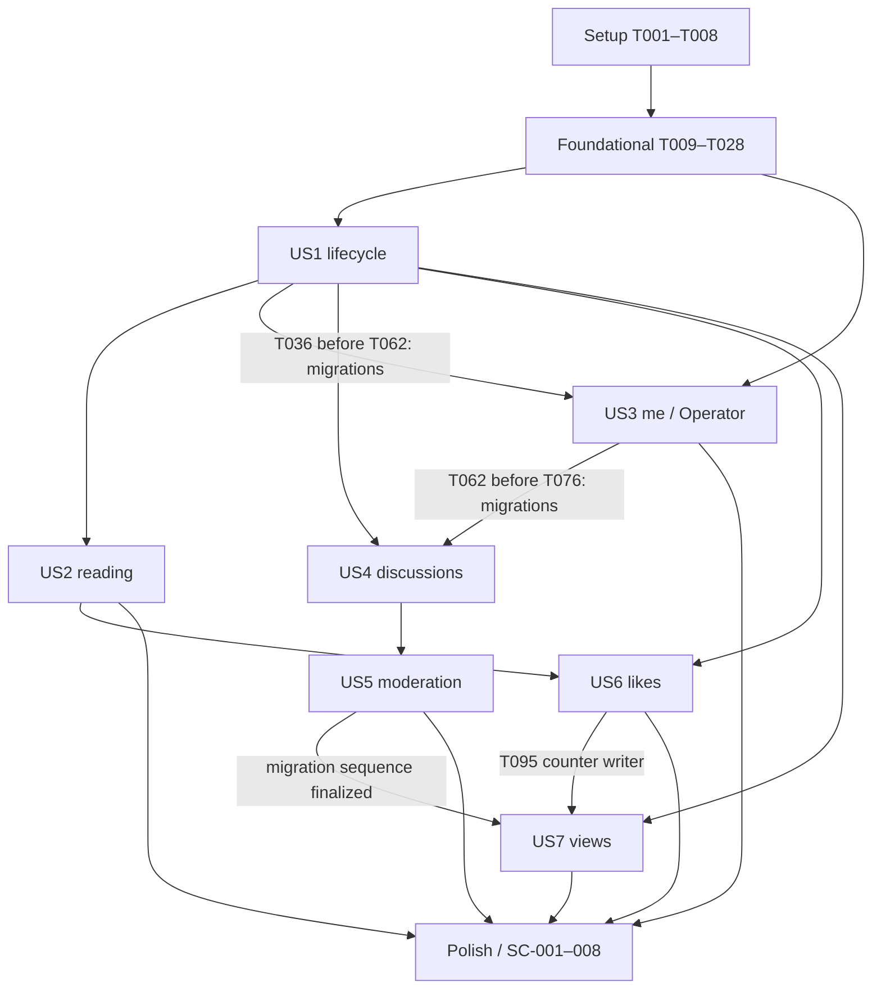

# Tasks: Универсальный Blog Engine — MVP

**Изменение объёма, 2026-10-24**: по решению владельца нагрузочный SC-005
не требуется на текущем этапе проекта/для релиза 1.0.0. T121 закрыт без прогона;
это снятие требования, а не успешная нагрузочная приёмка. Остальные проверки
и критерии самого benchmark сохраняются. Phase 1–10 завершены в этом объёме.

**Input**: `specs/001-blog-engine-mvp/`: `plan.md`, `spec.md`, `research.md`, `data-model.md`, `contracts/openapi.yaml`, `contracts/operations.md`, `quickstart.md`; конституция `.specify/memory/constitution.md` 1.0.0.

**Prerequisites**: согласованные Q1–Q3, решения R-01–R-09 и ограничения `references/source-constraints.md`. Все пути ниже относительны корню репозитория. Указанные файлы приложения предстоит создать: сейчас репозиторий содержит проектные документы.

**Tests**: обязательны по QR-002, SC-001–008 и конституции V. Использовать unit-тесты без сети/БД и HTTP/persistence-тесты с настоящим PostgreSQL 18.6 и настоящим JwtBearer middleware. В каждой фазе сначала добавить перечисленные проверки и подтвердить их ожидаемую неуспешность до соответствующей реализации; повторные проверки уже реализованного общего поведения остаются регрессионными. Не подменять PostgreSQL EF InMemory/SQLite и не заменять проверку JWT фиктивной схемой аутентификации.

**Organization**: общие механизмы личности находятся в Foundational, поскольку нужны нескольким историям. US3 поставляет `/me` и операторское управление ролями, а не повторную реализацию этих механизмов. US1 включает минимальное публичное чтение материала для своей независимой приёмки; US2 добавляет ленту и завершает коллекционные/read-сценарии. Схема лайков появляется в US1 как зависимость персонализированного detail; запись лайков — только в US6.

## Format: `[ID] [P?] [Story] Description`

- Каждая задача имеет checkbox, последовательный ID и точные пути файлов; `[USn]` присутствует только в фазах историй.
- `[P]` разрешает параллельное выполнение задач одного готового блока в разных файлах. Маркер не отменяет предпосылки фазы, тестовый этап и явно указанные зависимости.
- Контракты модулей не содержат EF/HTTP/IQueryable; один DbContext и одна цепочка миграций находятся в Infrastructure. Не вводить generic repository/UoW, MediatR или дополнительные сервисы без новой согласованной причины.
- Нормативные ограничения полей приведены в описаниях задач дословными цитатами из `data-model.md`; SQL-тип/NULL/NOT NULL и FK/UNIQUE/CHECK реализуются вместе с ними. Остальные детали соответствующей таблицы также обязательны.
- Результаты проверок сохраняются в игнорируемом `artifacts/`; в задачах ниже файл отчёта является проверяемым выходом, а не заявлением об уже выполненной проверке. Недоступный инструмент или стенд не считается успехом.

## Path Conventions

- Production: `src/BlogEngine.Core/`, `src/BlogEngine.Infrastructure/`, `src/BlogEngine.Api/`, `src/BlogEngine.Operator/`.
- Проверки: `tests/BlogEngine.UnitTests/`, `tests/BlogEngine.IntegrationTests/`, `tests/BlogEngine.Performance/`.
- Эксплуатация: `scripts/validation/`, `scripts/performance/`, `ops/database/`, `docs/operations/`.

## Phase 1: Setup (Shared Infrastructure)

**Purpose**: воспроизводимые solution, зависимости и изолированные средства проверки.

- [X] T001 Создать `BlogEngine.slnx`, `src/BlogEngine.Core/BlogEngine.Core.csproj`, `src/BlogEngine.Infrastructure/BlogEngine.Infrastructure.csproj`, `src/BlogEngine.Api/BlogEngine.Api.csproj` и `src/BlogEngine.Operator/BlogEngine.Operator.csproj` с графом Core ← Infrastructure, Api/Operator → Core + Infrastructure, модульными каталогами из plan.md и отдельными HTTP/console hosts.
- [X] T002 Добавить в solution `tests/BlogEngine.UnitTests/BlogEngine.UnitTests.csproj`, `tests/BlogEngine.IntegrationTests/BlogEngine.IntegrationTests.csproj` и console harness `tests/BlogEngine.Performance/BlogEngine.Performance.csproj`; разрешить WebApplicationFactory доступ к API entry point и выбрать VSTest без смешивания с MTP.
- [X] T003 Закрепить SDK 10.0.402, C# 14/net10.0/NRT/анализаторы в `global.json` и `Directory.Build.props`, версии в `Directory.Packages.props` и `packages.lock.json` каждого проекта, dotnet-ef 10.0.13 в `.config/dotnet-tools.json`: ASP.NET Core/JwtBearer/OpenAPI/Mvc.Testing и EF Core/Design 10.0.13, Npgsql/provider 10.0.3, Swagger UI 10.3.1, xunit.v3 4.0.2, adapter 4.0.1, Test SDK 18.11.0, Testcontainers.PostgreSql 4.16.0; проверить locked restore.
- [X] T004 [P] Настроить стиль и исключения результатов/секретов в `.editorconfig` и `.gitignore`, сохранив существующие правила Spec Kit и разрешив версионирование package lock-файлов.
- [X] T005 [P] Создать `compose.yaml` только с локальным PostgreSQL 18.6, UTF-8/UTC/collation C без расширений, защищёнными env credentials и закреплённым фактически полученным image digest; сохранить ту же ссылку образа для тестов в `tests/BlogEngine.IntegrationTests/Fixtures/PostgresImage.cs`.
- [X] T006 [P] Создать `.github/workflows/ci.yml` с SDK pin, locked restore, Release build без предупреждений, format verification и unit/integration suites на доступном Linux Docker engine; недоступность БД и пропуски тестов должны завершать job неуспешно.
- [X] T007 [P] Дополнить `README.md` и создать `src/BlogEngine.Api/appsettings.json`, `src/BlogEngine.Operator/appsettings.json` с именами обязательных параметров без секретов/выдуманных рабочих endpoints; задать разные UserSecretsId в соответствующих `.csproj` после T001 и описать раздельные API/Operator/migration credentials.
- [X] T008 Создать `tests/BlogEngine.IntegrationTests/Fixtures/PostgresFixture.cs`, `tests/BlogEngine.IntegrationTests/Fixtures/ApiFactory.cs`, `tests/BlogEngine.IntegrationTests/Fixtures/JwksFixture.cs` и `tests/BlogEngine.IntegrationTests/Fixtures/ConcurrencyBarrier.cs`: реальные миграции/изолированные данные, отдельные connections/contexts, одноразовые RSA/JWKS/JWT, управляемое время и явные барьеры без sleep и зависимости от живого Identity.

**Checkpoint**: проекты восстанавливаются, фикстуры запускают изолированный PostgreSQL и реальный HTTP-конвейер; отсутствие Docker фиксируется как блокировка будущих интеграционных проверок.
**Результат Phase 1 (2026-10-24)**: T001–T008 завершены. SDK/tool restore, locked restore, Release build (0 warnings), format verification, 6 unit- и 4 integration-теста без пропусков прошли; также выполнен Linux-прогон на SDK 10.0.402 с настоящим PostgreSQL. Compose подтвердил 18.6/UTF8/UTC/C. Code review и проверка constitution выполнены; замечания исправлены. Отчёт и логи: игнорируемый `artifacts/setup/verification.md`, TRX: `artifacts/test-results/` и `artifacts/linux/`.

Для выбранного VSTest используется официальный вариант xUnit v3 `xunit.v3.mtp-off` 4.0.2: метапакет `xunit.v3` 4.0.2 включает MTP v2. Test-only миграция `FixtureProbe` проверяет каркас; production DbContext/Accounts migrations остаются задачей T016. Фаза Foundational не начата.

## Phase 2: Foundational (Blocking Prerequisites)

**Purpose**: общие границы, проверенная личность, безопасный HTTP и минимальная Accounts-схема. Блокирует все истории.

### Обязательные проверки основы

- [X] T009 [P] Добавить `tests/BlogEngine.UnitTests/Architecture/DependencyTests.cs`, проверяющий независимость Core от ASP.NET/EF/Npgsql/Identity SDK, отсутствие циклов модулей и разрешённые зависимости Publishing → Accounts, Discussions/Engagement → Accounts + Publishing, ReadModels → публичные read-контракты модулей; Accounts не зависит от продуктовых модулей.
- [X] T010 [P] Добавить `tests/BlogEngine.UnitTests/Shared/InputRulesTests.cs` для Unicode scalar length, точного White_Space trim, U+0000, UTF-8 bytes, строгого slug и checked int64 offset, включая page=int.MaxValue и пустые дальние страницы без сужения в Skip(int).
- [X] T011 [P] Добавить `tests/BlogEngine.IntegrationTests/Authentication/JwtPipelineTests.cs` и `tests/BlogEngine.IntegrationTests/Authentication/JwksLifecycleTests.cs` (Category=Authentication): RS256/typ=JWT, точные issuer/audience, обязательные однозначные scalar claims sub/sid UUID, client_id/jti/token_use/iat/nbf/exp, skew 30 s, future iat, неверная подпись/alg/типы/дубликаты/refresh/oversized JWT; fixed JWKS URL, запрет redirect/jku/x5u, лимиты 16 KiB JWT и 256 KiB/32 keys JWKS, rotation/removal, max-age ≤300 s, single-flight, cooldown 30 s даже после отказа, timeout 5 s, один async refresh/retry и различия 401/503 без anonymous fallback.
- [X] T012 [P] Добавить `tests/BlogEngine.IntegrationTests/Accounts/BootstrapTests.cs` и `tests/BlogEngine.UnitTests/Accounts/AccessPolicyTests.cs` (Category=Authorization/Concurrency для integration): через тестовый protected probe в ApiFactory с настоящим JwtBearer middleware проверить, что 100 одновременных первых обращений дают одну связь issuer+sub и только Reader, неверный JWT не создаёт LocalUser, роли JWT не дают прав, Author/Moderator независимы, Admin объединяет права, новая операция перечитывает роли; probe существует только в тестовом host и не добавляет production endpoint до US3.
- [X] T013 [P] Добавить `tests/BlogEngine.IntegrationTests/Http/InfrastructureContractTests.cs` и `tests/BlogEngine.IntegrationTests/Operations/FoundationHealthTests.cs` (Category=ConsumerContract/Operations): ProblemDetails для malformed/unknown JSON, bodyless routes, 8 MiB/413, неизвестных маршрутов/методов/Accept/media type, auth challenge/forbid, outage БД/JWKS, безопасных логов и startup config; live не зависит от внешних сервисов, ready восстанавливается через общий bounded loader.

### Реализация основы

- [X] T014 Создать `src/BlogEngine.Core/Shared/TextRules.cs`, `src/BlogEngine.Core/Shared/PageRequest.cs`, `src/BlogEngine.Core/Shared/DomainError.cs` и `src/BlogEngine.Core/Shared/IUtcClock.cs`: соблюдать «Строковые лимиты в символах считаются по Unicode scalar values, как PostgreSQL `char_length`, а не по числу UTF-16 code units», отклонять U+0000; trim только U+0009–U+000D, U+0020, U+0085, U+00A0, U+1680, U+2000–U+200A, U+2028–U+2029, U+202F, U+205F, U+3000; страницы page≥1/default 1, pageSize 1–100/default 20, checked int64 offset и bounded pageSize+1.
- [X] T015 Создать `src/BlogEngine.Core/Accounts/Domain/LocalUser.cs`, `src/BlogEngine.Core/Accounts/Domain/RoleAssignment.cs`, `src/BlogEngine.Core/Accounts/Contracts/CurrentActor.cs` и `src/BlogEngine.Core/Accounts/Contracts/IActorResolver.cs`: поля LocalUser id/issuer/subject/created_at — «Непрозрачный стабильный публичный ID автора», «Точный проверенный issuer единственной настроенной установки Identity», «Единственный проверенный `sub` внешнего пользователя», «Момент первого успешного bootstrap»; issuer/subject/created_at обязательны, связь неизменяема, UNIQUE `(issuer, subject)`, CHECK непустого issuer; назначения user_id/role/granted_at обязательны, «Существующая LocalUser», «Только Author=1, Moderator=2, Admin=3», «Время назначения», PK `(user_id, role)`/FK RESTRICT; Reader не хранится и не отзывается, внешние профили/секреты не сохраняются.
- [X] T016 Создать `src/BlogEngine.Infrastructure/Persistence/BlogDbContext.cs`, `src/BlogEngine.Infrastructure/Persistence/Accounts/LocalUserConfiguration.cs`, `src/BlogEngine.Infrastructure/Persistence/Accounts/RoleAssignmentConfiguration.cs`, `src/BlogEngine.Infrastructure/Persistence/BlogDbContextFactory.cs` и начальную миграцию `src/BlogEngine.Infrastructure/Persistence/Migrations/InitialAccounts.cs` с model snapshot: snake_case/accounts, uuid/timestamptz UTC, именованные NOT NULL/UNIQUE/CHECK/FK RESTRICT из T015, одна цепочка migrations, design-time путь без запуска API/JWKS и без EnsureCreated.
- [X] T017 Реализовать `src/BlogEngine.Infrastructure/Persistence/Accounts/ActorResolver.cs`: после полной JWT verification INSERT ON CONFLICT DO NOTHING и отдельный следующий SELECT в READ COMMITTED, затем роли из БД в начале каждой операции без role cache; не объединять INSERT/fallback SELECT в один CTE snapshot и не принимать client user ID/role.
- [X] T018 Создать типизированные параметры и startup validation в `src/BlogEngine.Api/Configuration/IdentityOptions.cs`, `src/BlogEngine.Api/Configuration/ApiOptions.cs`, `src/BlogEngine.Operator/OperatorOptions.cs`: API требует точные issuer/audience/fixed JWKS URL и DB connection, HTTPS JWKS в production/HTTP только явно локальному dev; Operator требует только issuer и отдельный DB connection; применять standard configuration providers и host/request CancellationToken.
- [X] T019 Реализовать `src/BlogEngine.Infrastructure/Identity/JwksLoader.cs` и `src/BlogEngine.Infrastructure/Identity/JwksSnapshot.cs` с публичными RSA RS256 signing keys/уникальным kid, atomic snapshot, max freshness 300 s с меньшим max-age, single-flight/cooldown 30 s/timeout 5 s/лимитами из T011; stale/removed keys не использовать, malformed snapshot не заменяет пригодный, fixed HttpClient не следует redirect.
- [X] T020 Подключить штатный JwtBearer/IdentityModel в `src/BlogEngine.Api/Configuration/BearerAuthentication.cs` и async adapter `src/BlogEngine.Infrastructure/Identity/BearerKeyValidation.cs`: MapInboundClaims=false, SaveToken=false, IncludeErrorDetails=false, RS256/exact issuer/audience/skew 30 s, IgnoreTrailingSlashWhenValidatingAudience=false, TryAllIssuerSigningKeys=false, строгие claims/limits из T011; один async refresh/retry без блокирующего resolver и без изменения общих options на запрос, без Authority/discovery/introspection.
- [X] T021 Реализовать общий снимок личности и политики действия/ресурса в `src/BlogEngine.Core/Accounts/Application/AccessPolicy.cs` и `src/BlogEngine.Api/Configuration/CurrentActorAccessor.cs`, используя T017/T020: deny-by-default, публичность только явно, optional Bearer всегда проверяется, полномочия/владелец только из проверенного контекста; authentication 401, недостаток прав 403, скрывающий доступ 404 до проверки версии.
- [X] T022 Создать `src/BlogEngine.Api/Diagnostics/ProblemDetailsHandler.cs`, `src/BlogEngine.Api/Diagnostics/RequestLogging.cs` и `src/BlogEngine.Infrastructure/Persistence/DatabaseErrorMapper.cs`: все коды из operations.md, application/problem+json/code/traceId/field errors и WWW-Authenticate: Bearer, безопасные 400/401/403/404/405/406/409/413/415/500/503; именованные DB violations переводить только в известные ошибки, unexpected error логировать один раз, штатную отмену отличать от 500, не писать body/SQL/токены/visitor IDs/секреты.
- [X] T023 Реализовать `src/BlogEngine.Api/Contracts/ResourceVersion.cs` и `src/BlogEngine.Api/Configuration/RequestContractValidation.cs`: единственный UUID X-Resource-Version для изменяемых ресурсов, missing/malformed=400, stale=409 после доступа, без ETag/If-Match; strict DTO/unknown properties, запрет body у методов без requestBody, decoded Markdown limit отдельно от JSON envelope 8 MiB и предсказуемые ошибки UUID/query/media type.
- [X] T024 Собрать общий host в `src/BlogEngine.Api/Program.cs` и `src/BlogEngine.Api/Configuration/ApiRegistration.cs`: DI Core/Infrastructure, async cancellation/timeouts, JSON UTC с Z, CORS allowlist без cookies, private/no-store + Vary: Authorization для optional-Bearer content и no-store для protected responses; включить OpenAPI 3.1 и Swagger UI только в Development без startup migrations.
- [X] T025 Реализовать `src/BlogEngine.Api/Endpoints/HealthEndpoints.cs` и `src/BlogEngine.Infrastructure/Identity/DependencyReadiness.cs`: get healthLive=200 без внешних запросов, healthReady=200 только при PG и fresh usable JWKS, иначе безопасный 503; probe использует T019/cooldown и bounded recovery, fresh cache допускает outage, внутреннее ingress-ограничение readiness описать в `docs/operations/health.md`.
- [X] T026 Объявить чистые read/transaction границы в `src/BlogEngine.Core/ReadModels/AuthorRef.cs`, `src/BlogEngine.Core/ReadModels/PageResult.cs`, `src/BlogEngine.Core/Publishing/Contracts/IPublicationWriteScope.cs` и `src/BlogEngine.Core/Publishing/Contracts/IPublicationReader.cs`: публичный автор только local UUID, read DTO без EF/IQueryable, единый scope материала для Discussions/Engagement и bounded counter delta; владение и допустимые зависимости соответствуют plan.md, без отдельного универсального UoW.
- [X] T027 Создать `ops/database/permissions.sql` для уже существующих Accounts-таблиц и `docs/operations/database.md`: отдельные owner/migration/runtime/operator principals и секреты вне Git, runtime только нужные bootstrap DML/SELECT ролей, operator SELECT local_users/roles, без DDL, без автоматической выдачи Admin; далее расширять grants только для таблиц соответствующей миграции.
- [X] T028 Выполнить foundation unit/real-PG HTTP проверки T009–T013, проверить InitialAccounts SQL/constraints и запреты DB principal; сохранить команды, исходы и блокировки в `artifacts/validation/foundation.md`, исправив реализации T014–T027 до успешного результата.

**Checkpoint**: общая личность и права работают без `/me`/CLI; тестовые LocalUser/назначения создаются только привилегированной изолированной фикстурой. Все последующие истории используют эту основу.

**Результат Phase 2 (2026-10-24)**: T009–T028 завершены. Реализованы общие Core/Accounts-контракты, InitialAccounts, конкурентный bootstrap, JWT/JWKS, локальные политики, HTTP/ProblemDetails/version/лимиты, конфигурация, health и раздельные DB privileges. Code review и проверка constitution 1.0.0 выполнены, замечания исправлены. Windows и Linux SDK 10.0.402: locked restore, Release build (0 warnings/errors), format verification, 22 unit- и 38 integration-тестов на настоящем PostgreSQL 18.6 без пропусков прошли. SQL миграции/constraints, Down/reapply, отсутствие model drift и запреты DB principals проверены. Подробный отчёт и диагностические исходы: игнорируемый `artifacts/validation/foundation.md`. Реальный Identity и production deployment не проверялись. Phase 3 не начата.

## Phase 3: User Story 1 — Автор готовит и публикует материал (Priority: P1) 🎯 MVP

**Goal**: lifecycle Draft/Published, рабочая область, справочники и минимальное публичное detail.

**Independent Test**: на fixture Author/Admin создать Draft, проверить скрывающий 404 для anonymous/чужого Author, назначить справочники, опубликовать и анонимно прочитать по ID/slug, изменить Published, unpublish/republish с прежней первой датой, удалить и проверить вечную резервацию slug; обсуждения и мутации реакций не требуются.

### Tests for User Story 1

- [X] T029 [P] [US1] Добавить `tests/BlogEngine.UnitTests/Publishing/PublicationTests.cs` (Publishing): точные Unicode/UTF-8/nullable/HTTPS/slug/5+20 границы, пустой Draft и запрет blank publish, неизменные owner/first date/slug после первой публикации, прямое Published edit, tombstone и current-version no-op Publish/Unpublish без смены дат/версии.
- [X] T030 [P] [US1] Добавить `tests/BlogEngine.UnitTests/Publishing/TaxonomyTests.cs` для 1–80 scalar name, формата/неизменности slug, независимой уникальности category/tag и ограничений назначения без дублей/несуществующих ID.
- [X] T031 [P] [US1] Добавить `tests/BlogEngine.IntegrationTests/Publishing/LifecycleContractTests.cs` и `tests/BlogEngine.IntegrationTests/Publishing/TaxonomyContractTests.cs` (Publishing/ConsumerContract): все publishing/workspace/taxonomy операции OpenAPI, роли/владение/закрытость, 201/200/204, version header/400/409, неизвестные поля и подмена системных дат/owner/state/counters; rename виден в detail, используемый справочник не удаляется, private/public DTO не смешиваются.
- [X] T032 [P] [US1] Добавить `tests/BlogEngine.IntegrationTests/Publishing/PublishingConcurrencyTests.cs` и `tests/BlogEngine.IntegrationTests/Publishing/PublishingConstraintTests.cs` (Publishing/Concurrency): гонка slug, edit/edit и stale no-op, assignment/delete taxonomy, rollback контента/joins, глобальный UNIQUE tombstone slug, NOT NULL/CHECK/FK, сравнение SQL Unicode trim с валидатором и отсутствие перезаписи counters содержательным UPDATE.

### Implementation for User Story 1

- [X] T033 [P] [US1] Создать `src/BlogEngine.Core/Publishing/Domain/Publication.cs`: id «Системный ID материала», обязательный author_id «Неизменный владелец, LocalUser»; обязательные title «После trim 1–200 символов», slug «Строгий формат и длина 1–120», markdown «До 1 048 576 байт UTF-8; пустой допустим только в Draft», state «Draft=0, Published=1»; nullable description «До 500 символов», cover_url «До 2048 символов; абсолютный HTTPS URI»; системные обязательные created_at «Назначается при создании», updated_at «Последняя содержательная запись» и version «Версия редактирования/жизненного цикла/классификации», nullable first_published_at «Назначается один раз при первой публикации»/deleted_at «Терминальная метка удаления»; обязательные bigint/default 0 like_count «Текущее число действующих лайков» и view_count «Накопленные учтённые открытия», неотрицательные; реализовать переходы таблицы lifecycle data-model.md без восстановления и без HTML rendering.
- [X] T034 [P] [US1] Создать `src/BlogEngine.Core/Publishing/Domain/Category.cs`, `src/BlogEngine.Core/Publishing/Domain/Tag.cs` и `src/BlogEngine.Core/Publishing/Domain/PublicationClassification.cs`: id «Системный ID», обязательные name «После trim 1–80 символов», slug «Формат Publication.slug, неизменен после создания», version «Меняется при переименовании»; отдельные UNIQUE slug, назначение «Кардинальности 0–5 категорий/0–20 тегов» и отсутствие повторов, системная версия UUID, immutable slug без trim/lowercase.
- [X] T035 [US1] Добавить mappings в `src/BlogEngine.Infrastructure/Persistence/Publishing/PublicationConfiguration.cs`, `src/BlogEngine.Infrastructure/Persistence/Publishing/TaxonomyConfiguration.cs`, `src/BlogEngine.Infrastructure/Persistence/Publishing/ClassificationConfiguration.cs` и общую раннюю read-зависимость `src/BlogEngine.Core/Engagement/Domain/Like.cs`/`src/BlogEngine.Infrastructure/Persistence/Engagement/LikeConfiguration.cs`: все типы/nullability из T033–T034, UUID concurrency tokens, CHECK title/Markdown/state/dates/counters/HTTPS prefix, `char_length(slug) BETWEEN 1 AND 120 AND slug ~ '^[a-z0-9]+(-[a-z0-9]+)*$'`, UNIQUE slug включая tombstones, composite join PK/NOT NULL/FK RESTRICT; Like publication_id «Существующий материал», user_id «Проверенная LocalUser», created_at «Время первого установления текущего лайка», все обязательны, PK `(publication_id, user_id)`/FK RESTRICT; write API лайков здесь не добавлять.
- [X] T036 [US1] Создать миграцию `src/BlogEngine.Infrastructure/Persistence/Migrations/AddPublishing.cs` и обновить `ops/database/permissions.sql`: publishing/likes schema, индексы recent/popular/workspace/taxonomy/joins из data-model.md §7, FK local_users и именованные ограничения; runtime получает нужный DML, operator не получает доступ к бизнес-контенту; проверить SQL/применение с нуля и после InitialAccounts.
- [X] T037 [US1] Реализовать `src/BlogEngine.Infrastructure/Persistence/Publishing/PublicationWriteScope.cs`: короткий READ COMMITTED scope/SELECT FOR UPDATE, повторная проверка state/deleted/ownership/version после ожидания, общий connection/transaction без вложенных commits, порядок publication UUID ASC → дочерние строки, DB UTC clock после lock; запрещены внешние HTTP/JWKS внутри транзакции и слепой retry содержательной записи.
- [X] T038 [US1] Реализовать Admin create/rename/delete категорий/тегов в `src/BlogEngine.Core/Publishing/Application/TaxonomyService.cs` и `src/BlogEngine.Infrastructure/Persistence/Publishing/TaxonomyStore.cs`: локальные права, проверка client version с UPDATE/DELETE predicate, immutable slug, именованные 409 slug_conflict/taxonomy_in_use/concurrency_conflict, FK RESTRICT при гонке с назначением.
- [X] T039 [US1] Реализовать create/edit/publish/unpublish/delete в `src/BlogEngine.Core/Publishing/Application/PublicationService.cs` и `src/BlogEngine.Infrastructure/Persistence/Publishing/PublicationStore.cs` через T037: текущий actor, атомарные контент/до 25 joins, проверка существования classification, клиентская version в условии записи, первая дата один раз, опубликованные правки сразу видны, current-version no-op не вращает version, delete снимает joins и оставляет недоступный tombstone без массового cascade.
- [X] T040 [US1] Создать `src/BlogEngine.Api/Contracts/Publishing/PublicationWrite.cs`, `src/BlogEngine.Api/Contracts/Publishing/TaxonomyWrite.cs` и `src/BlogEngine.Api/Contracts/Publishing/PublishingValidation.cs` по OpenAPI: обязательные title/slug/markdown/categoryIds/tagIds, omission description/coverUrl очищает в null, scalar/UTF-8/HTTPS/strict slug/5+20 ограничения из T033–T034, запрет системных полей/unknown properties и приёма клиентской version в body.
- [X] T041 [US1] Реализовать `src/BlogEngine.Infrastructure/ReadModels/WorkspaceQueries.cs`, `src/BlogEngine.Api/Contracts/Publishing/WorkspacePublication.cs` и `src/BlogEngine.Api/Endpoints/WorkspaceEndpoints.cs`: Author только своё/Admin всё, deleted исключены, фильтр state, updated_at/id DESC, bounded страницы/карточки без Markdown, detail с Markdown/state/version; чужой Draft/absent/deleted=404, чужой Published edit-context=403, Moderator без Author/Admin не читает Draft.
- [X] T042 [US1] Добавить `src/BlogEngine.Api/Endpoints/PublicationCommandEndpoints.cs` с createPublication/updatePublication/deletePublication/publishPublication/unpublishPublication, точными HTTP-кодами/DTO/Location из `contracts/openapi.yaml`, обязательной edit version для мутаций существующего ресурса и регистрацией в `src/BlogEngine.Api/Program.cs`.
- [X] T043 [US1] Добавить `src/BlogEngine.Infrastructure/ReadModels/TaxonomyQueries.cs`, `src/BlogEngine.Api/Contracts/Publishing/TaxonomyDto.cs` и `src/BlogEngine.Api/Endpoints/TaxonomyEndpoints.cs`: list/get/create/rename/delete для categories и tags, публичные bounded name COLLATE C/id ASC чтения, Admin writes, UUID version и optional Bearer/cache semantics согласно OpenAPI; зарегистрировать endpoints в `src/BlogEngine.Api/Program.cs`.
- [X] T044 [US1] Реализовать минимальное публичное getPublication/getPublicationBySlug в `src/BlogEngine.Infrastructure/ReadModels/PublicationDetailQuery.cs`, `src/BlogEngine.Api/Contracts/Reading/PublicationDto.cs` и `src/BlogEngine.Api/Endpoints/PublicationReadEndpoints.cs`: только `state = 1 AND deleted_at IS NULL`, полный недоверенный Markdown, AuthorRef local ID, dates/classification/counters и EXISTS личного лайка, анонимно false; Draft/deleted/absent=404 даже владельцу, GET не меняет counters, edit version не публикуется в публичном detail; зарегистрировать в `src/BlogEngine.Api/Program.cs`.
- [X] T045 [US1] Прогнать T029–T032 на реальном PostgreSQL с ролью runtime и выполнить независимый lifecycle/taxonomy walkthrough, включая оба исхода гонки назначения/удаления и неизменность системных полей; сохранить безопасный результат SC-001/начальной части SC-002 в `artifacts/validation/us1.json`.
- [X] T046 [US1] Проверить фактические `AddPublishing` SQL/индексы, upgrade InitialAccounts → AddPublishing, terminal deletion/slug/joins и границы модулей после реализации; устранить найденные нарушения и записать команды/исходы в `artifacts/validation/us1-migrations.md`.

**Результат Phase 3 (2026-10-24)**: T029–T046 завершены. Реализованы lifecycle публикаций, workspace, справочники, публичный detail, AddPublishing и runtime privileges. Code review и проверка constitution 1.0.0 выполнены; замечания исправлены. Locked restore, Release build (0 warnings/errors), format verification, 25 unit- и 51 integration-тест на PostgreSQL 18.6 без пропусков прошли. Fresh/upgrade/Down/reapply migrations, отсутствие model drift, constraints, SQL/query count/EXPLAIN и гонки/rollback проверены. Отчёт: игнорируемый `artifacts/validation/us1-migrations.md`; сценарий: `artifacts/validation/us1.json`; TRX: `artifacts/test-results/`. Реальный Identity, production rollout и SC-005 не проверялись. Phase 4 не начата.

**Checkpoint**: US1 доставляет авторский цикл и его анонимную проверку. Fixture elevated roles достаточны для независимой приёмки; эксплуатационный выпуск ждёт Operator из US3.

## Phase 4: User Story 2 — Читатель находит и читает публикации (Priority: P1)

**Goal**: ограниченная публичная лента, фильтры/сортировки, счётчики и персонализированное чтение.

**Independent Test**: на fixture-наборе 250 материалов с ties, разными состояниями, категориями/тегами/лайками обойти страницы recent/popular 20/100 без повторов/пропусков, проверить ANY категорий AND ALL тегов, detail ID=slug, пустую дальнюю страницу, корректные counters/личный лайк и ≤5 data queries независимо от размера страницы. Создание контента/реакций выполняет фикстура, CLI/обсуждения не нужны.

### Tests for User Story 2

- [X] T047 [P] [US2] Добавить `tests/BlogEngine.IntegrationTests/Reading/ReadingContractTests.cs` (Reading/ConsumerContract): listPublications/getPublication/getPublicationBySlug/getCounters, точный состав DTO без Markdown в feed и с Markdown в detail, optional Bearer failures/cache headers, отсутствие Identity PII/edit version в public detail, GET не учитывает просмотр, Draft/deleted/absent дают одинаковый 404.
- [X] T048 [P] [US2] Добавить `tests/BlogEngine.IntegrationTests/Reading/PaginationAndFilterTests.cs` и его fixture `tests/BlogEngine.IntegrationTests/Fixtures/ReadingDataset.cs` (Reading): 250 неизменных материалов, ties в обеих сортировках, размеры 20/100, обход без дублей/пропусков, page≥1/defaults/int32 max с int64 offset, пустая последующая страница, ANY categories AND ALL tags, пустые/неизвестные/дублированные/превышающие 5+20 фильтры и плохие sort/state/UUID.
- [X] T049 [P] [US2] Добавить `tests/BlogEngine.IntegrationTests/Reading/BoundedQueryTests.cs` (Reading): DTO projection/AsNoTracking, отсутствие lazy loading/N+1/Markdown в карточках, ≤5 data queries для страницы 20/100 со всеми фильтрами, отдельный учёт фиксированных auth/bootstrap запросов, корректное EXISTS личного лайка без загрузки списка пользователей.

### Implementation for User Story 2

- [X] T050 [P] [US2] Определить `src/BlogEngine.Core/ReadModels/PublicationFeed.cs`, `src/BlogEngine.Core/ReadModels/Counters.cs` и `src/BlogEngine.Core/ReadModels/IPublicFeedReader.cs`: разрешённые read-контракты Publishing/Engagement без циклических зависимостей, bounded DTO page/items/pageSize/hasNextPage, local AuthorRef, текущие неотрицательные bigint counters и личное состояние из verified actor.
- [X] T051 [P] [US2] Создать `src/BlogEngine.Api/Contracts/Reading/FeedRequest.cs`, `src/BlogEngine.Api/Contracts/Reading/PublicationCardDto.cs`, `src/BlogEngine.Api/Contracts/Reading/CountersDto.cs`: повторяемые categoryIds/tagIds, уникальные UUID/максимум 5/20, sort=recent|popular/default recent, общая PageRequest/нормативные nullable/required поля и отсутствие произвольных author/user ID.
- [X] T052 [US2] Реализовать `src/BlogEngine.Infrastructure/ReadModels/PublicFeedQuery.cs`: точный public predicate, серверные EXISTS ANY категорий и ALL тегов, два bounded batch existence-check фильтров, recent first_published_at/id DESC и popular like_count/first_published_at/id DESC, int64 SQL offset без Skip(int), pageSize+1 и два batch-запроса classification; максимум 5 data queries, параметризованный SQL и без COUNT/полного Markdown.
- [X] T053 [US2] Добавить `src/BlogEngine.Infrastructure/ReadModels/PublicationCountersQuery.cs` через разрешённые контракты: Published guard до выдачи counters, correlated EXISTS для текущего LocalUser, false anonymous, никаких записей/просмотров и никакого публичного liker/visitor list.
- [X] T054 [US2] Добавить listPublications/getCounters в `src/BlogEngine.Api/Endpoints/FeedEndpoints.cs` и `src/BlogEngine.Api/Endpoints/CounterEndpoints.cs`, зарегистрировать в `src/BlogEngine.Api/Program.cs`; согласовать detail из T044 с карточками/фильтрами/персонализацией, сохранить private,no-store/Vary: Authorization даже анонимно и отказ на плохой Bearer.
- [X] T055 [US2] Создать `tests/BlogEngine.IntegrationTests/Reading/QueryInspectionTests.cs`, используя готовый ReadingDataset из T048 для повторяемых 250 материалов/совпадающих дат/seed лайков, и сохранять параметризованный SQL/число команд/EXPLAIN JSON recent/popular, pageSize 20/100, дальние страницы и комбинации фильтров в `artifacts/validation/queries/`; не привязывать assert к конкретному planner node.
- [X] T056 [US2] Прогнать T047–T049/T055, проверить независимое чтение и SC-006 для материалов, сравнить anonymous/двух пользователей с разными лайками и запрет общей кеш-доставки; записать результаты Reading/QR-001/части SC-002 в `artifacts/validation/us2.json`, исправив SQL/индексы по фактическому плану при необходимости.

**Результат Phase 4 (2026-10-24)**: T047–T056 завершены. Добавлены публичная лента recent/popular, ANY категорий AND ALL тегов, bounded int64 offset/pageSize+1, DTO без Markdown, counters и персонализация optional Bearer. Code review и проверка constitution 1.0.0 выполнены; блокирующих замечаний нет. Locked restore, Release build (0 warnings/errors), format verification, 26 unit- и 64 integration-теста на PostgreSQL 18.6 без пропусков прошли. Дополнительная итоговая проверка ReadingContractTests подтверждает 404 для владельца/Admin. На 250 детерминированных материалах проверены 96 SQL/EXPLAIN-сценариев: максимум 5 data queries + 3 фиксированных auth/bootstrap, reader не более 101 строки, без tracking/N+1/Markdown. Миграций и изменений permissions не потребовалось; существующие индексы используются, model drift отсутствует. Отчёт: игнорируемый `artifacts/validation/us2-review.md`; независимый сценарий: `artifacts/validation/us2.json`; SQL/планы: `artifacts/validation/queries/us2-*.json`; TRX: `artifacts/test-results/us2-*.trx`. Приёмка SC-005 и реальный Identity не заявляются. Phase 5 не начата.

**Checkpoint**: US2 работает на seed без команд публикации/реакций; количественная SC-005 приёмка остаётся в финальной фазе на установленном стенде.

## Phase 5: User Story 3 — Платформа применяет локальные права (Priority: P1)

**Goal**: публично документированный `/me`, операторский CLI, атомарный аудит и разделение полномочий.

**Independent Test**: настоящий JWT вызывает `/me` и создаёт единственного Reader; отдельный Operator credential находит этого пользователя, назначает/отзывает Author/Moderator/Admin с аудитом, следующий HTTP-запрос с тем же JWT применяет новые права; HTTP Admin и runtime DB credential не меняют назначения/аудит. Остальные продуктовые операции для этого теста заменяются fixture ресурсами и проверкой общих policies.

### Tests for User Story 3

- [X] T057 [P] [US3] Добавить `tests/BlogEngine.IntegrationTests/Accounts/MeContractTests.cs` (Authorization/Authentication/ConsumerContract): getMe bootstrap, `{id,roles}` без PII, порядок Reader/Author/Moderator/Admin без дублей, role refresh на следующую операцию при прежнем JWT, изоляция issuer/project и отсутствие HTTP CRUD пользователей/ролей; регрессионно включить T011–T012.
- [X] T058 [P] [US3] Добавить `tests/BlogEngine.UnitTests/Accounts/OperatorCommandTests.cs`: users find/roles list/grant/revoke, exact configured issuer и UUID до SQL, только Author/Moderator/Admin, reason trim 1–512 Unicode scalars, запрет Reader/--actor/неизвестных аргументов/команд, idempotent no-op и output/exit/cancellation/outcome_unknown контракты operations.md.
- [X] T059 [P] [US3] Добавить `tests/BlogEngine.IntegrationTests/Accounts/OperatorIntegrationTests.cs` и `tests/BlogEngine.IntegrationTests/Accounts/DatabasePrivilegeTests.cs` (Authorization/Concurrency): запуск реального console host, exit 0/2/3/4/5/130, JSON stdout/stderr, audit при changed и no-op, rollback при audit failure, сериализация grant/revoke advisory lock, уникальный correlation ID, неизменяемый audit, runtime/operator/migration permissions и отсутствие HTTP/Identity вызовов CLI.
- [X] T060 [P] [US3] Добавить полную параметризованную матрицу роль × действие × владение в `tests/BlogEngine.UnitTests/Accounts/RoleActionMatrixTests.cs` и общий HTTP assertion helper `tests/BlogEngine.IntegrationTests/Fixtures/AuthorizationMatrix.cs`: Reader/Author/Moderator/совмещённые/Admin/anonymous, свои/чужие/закрытые ресурсы, подмена owner/roles и порядок 401/403/404 до версии; HTTP-кейсы подключать в собственных story suites по мере появления маршрутов, без disabled/skipped тестов.

### Implementation for User Story 3

- [X] T061 [US3] Создать `src/BlogEngine.Core/Accounts/Domain/RoleChangeAudit.cs` и `src/BlogEngine.Core/Accounts/Contracts/RoleChangeCommand.cs`: id «ID записи аудита»; обязательные UNIQUE command_correlation_id «ID конкретного выполнения CLI-команды; ключ проверки неизвестного commit-результата», FK target_user_id «Существующая LocalUser, RESTRICT», role «Author/Moderator/Admin, как в RoleAssignment», action «Grant=1 или Revoke=2», changed «Изменилось ли фактическое назначение», actor «Локальная OS/deployment identity выполняющего Operator», reason «Обязательная причина команды, 1–512 Unicode scalar values после trim», occurred_at «UTC-время изменения/идемпотентного результата»; CHECK role/action/непустого actor/нормализованной reason, audit неизменяем.
- [X] T062 [US3] Добавить `src/BlogEngine.Infrastructure/Persistence/Accounts/RoleChangeAuditConfiguration.cs`, миграцию `src/BlogEngine.Infrastructure/Persistence/Migrations/AddRoleChangeAudit.cs` и расширить `ops/database/permissions.sql`: NOT NULL/FK RESTRICT/UNIQUE correlation ID/CHECK из T061, индекс target_user_id/occurred_at DESC/id DESC; Operator SELECT local_users/roles/audit, INSERT/DELETE roles и INSERT audit, без UPDATE/DELETE audit/контента/DDL, runtime без любых прав audit и записи elevated roles; проверить upgrade AddPublishing → AddRoleChangeAudit.
- [X] T063 [US3] Реализовать `src/BlogEngine.Core/Accounts/Application/RoleAdministration.cs` и `src/BlogEngine.Core/Accounts/Contracts/IRoleAdministrationStore.cs`: только существующий LocalUser/exact issuer, Reader не назначается/отзывается, нет автоматического/последнего Admin, Author/Moderator независимы, каждый grant/revoke включая no-op требует reason/OS actor/correlation audit, mutation и audit — одна атомарная операция.
- [X] T064 [US3] Реализовать `src/BlogEngine.Infrastructure/Persistence/Accounts/RoleAdministrationStore.cs`: стабильное отображение local UUID в transaction-scoped advisory lock без UPDATE local_users, сериализация команд пользователя, idempotent назначение/снятие, DB UTC audit и commit вместе; cancellation до commit откатывает, после подтверждённого commit возвращает успех, потеря commit-ответа даёт outcome_unknown с поиском по correlationId.
- [X] T065 [US3] Создать `src/BlogEngine.Api/Contracts/Accounts/MeDto.cs` и `src/BlogEngine.Api/Endpoints/MeEndpoints.cs`, зарегистрировать getMe в `src/BlogEngine.Api/Program.cs`: реальный Bearer → T017 → local id/ordered roles, no-store, только штатные 200/401/503, без внешнего профиля и HTTP role mutation.
- [X] T066 [US3] Создать строгий parser `src/BlogEngine.Operator/CommandParser.cs` для четырёх форм команд из operations.md: exact issuer, UUID, role и reason проверить до SQL; отказ на повторных/неизвестных параметрах, Reader и --actor; actor получить из доверенного процесса/защищённой среды, не из пользовательского аргумента.
- [X] T067 [US3] Реализовать `src/BlogEngine.Operator/Program.cs` и `src/BlogEngine.Operator/CommandResultWriter.cs`: отдельный console DI/config/DB credential без HTTP и Identity клиента, stdout один success JSON с указанными контрактом полями, stderr один `{code,message,correlationId}`/пустой stdout при ошибке, exit 0/2/3/4/5/130, безопасная диагностика, Ctrl+C/timeout и outcome_unknown без ложного rollback.
- [X] T068 [US3] Создать `docs/operations/roles.md`: provisioning существующего Reader через `/me`, поиск issuer+subject, первый Admin/совмещение/grant/revoke/no-op/reason, разделение credentials, проверка неизвестного commit по audit correlationId, отзыв локальной роли со следующей операции и ограничение внешнего revocation до exp+30 s; реальные settings/secrets не включать.
- [X] T069 [US3] Прогнать полную policy matrix и T057–T060 с отдельными реальными PG principals, повторить 100 bootstrap-запросов и конкурентные operator команды; проверить, что API не может создать elevated assignment даже при Admin JWT и Operator не меняет контент; сохранить результат SC-007 в `artifacts/validation/us3-security.json`.
- [X] T070 [US3] Проверить миграцию AddRoleChangeAudit с нуля/upgrade, неизменяемость/атомарность audit, CLI exit/output/cancel/commit-uncertainty и next-operation role refresh; записать воспроизводимые команды/исходы в `artifacts/validation/us3-operator.md`.

**Результат Phase 5 (2026-10-24)**: T057–T070 завершены. Добавлены protected `/me`, строгий Operator CLI users find/roles list/grant/revoke, атомарный неизменяемый аудит, AddRoleChangeAudit и отдельные DB privileges. Самостоятельное code review и проверка constitution 1.0.0 выполнены; замечания исправлены, блокирующих замечаний нет. Windows и Linux SDK 10.0.402: locked restore, Release build (0 warnings/errors), format verification, 71 unit- и 82 integration-теста на PostgreSQL 18.6 без пропусков прошли. Проверены матрица прав/владения/404 до версии, 100 bootstrap-запросов, next-operation role refresh с прежним JWT, реальные runtime/operator/migration principals, конкурентные CLI-команды, no-op/audit rollback, exit/output 0/2/3/4/5/130, Linux Ctrl+C, отмена до commit/успех после commit и outcome_unknown. Fresh/upgrade/Down/reapply, идемпотентный SQL и отсутствие model drift подтверждены. Отчёт: игнорируемый `artifacts/validation/us3-operator.md`; SC-007: `artifacts/validation/us3-security.json`; SQL: `artifacts/validation/us3-migrations.sql`; TRX: `artifacts/test-results/us3-*-final.trx` и `artifacts/validation/us3-linux/`. Реальный Identity, production rollout и SC-005 не проверялись. Phase 6 не начата.

**Checkpoint**: эксплуатационный путь выдачи всех повышенных прав готов; реальные Identity credentials не требуются автоматическим тестам и не подставляются из примеров.

## Phase 6: User Story 4 — Пользователь участвует в обсуждении (Priority: P2)

**Goal**: немедленно публичные комментарии/ответы, owner edit/delete и ограниченное чтение дерева с безопасными заглушками.

**Independent Test**: на fixture Published/пользователях создать корень и ответ другого автора, исправить свой текст, удалить родителя, получить потомка через заглушку без текста/автора; обойти 250 корней с ветвями по 250 прямых ответов без пропусков/повторов отдельными bounded страницами и проверить глубину 5. Hidden состояния для owner-ограничений создаёт fixture; маршруты модерации не нужны.

### Tests for User Story 4

- [X] T071 [P] [US4] Добавить `tests/BlogEngine.UnitTests/Discussions/CommentTests.cs` (Discussions): scalar trim 1–5000, depth 1–5/корень 1, неизменные publication/parent/author, immediate Visible, owner/Admin edit/delete, запрет edit Hidden владельцем без Admin, Deleted с null text/без восстановления и current-version повтор delete без смены дат/версии.
- [X] T072 [P] [US4] Добавить `tests/BlogEngine.IntegrationTests/Discussions/DiscussionContractTests.cs` и `tests/BlogEngine.IntegrationTests/Discussions/TreePaginationTests.cs` (Discussions/ConsumerContract): roots/direct replies отдельно, 250 корней ×250 ответов плюс вложенные ветви, created_at/id ASC и page limits, cross-publication/hidden/deleted parent rejection, 404 недоступного parent, placeholder content/author null/hasReplies, Hidden owner edit-context content=null/version, Admin retained text, role/action matrix и invalid/unknown/version input.
- [X] T073 [P] [US4] Добавить `tests/BlogEngine.IntegrationTests/Discussions/CommentConcurrencyTests.cs` и `tests/BlogEngine.IntegrationTests/Discussions/CommentConstraintTests.cs` (Discussions/Concurrency): stale edit/delete, два API instance, создание/редактирование/удаление против unpublish/delete материала и удаления родителя, composite self-FK/NOT NULL/CHECK, rollback node+ancestor counts, неизменные version/updated_at предков и count, равный фактическим Visible-потомкам.

### Implementation for User Story 4

- [X] T074 [US4] Создать `src/BlogEngine.Core/Discussions/Domain/Comment.cs`: id «Системный ID комментария», обязательные publication_id «Неизменный материал»/author_id «Неизменный автор, LocalUser», nullable parent_id «Неизменный непосредственный родитель», depth «Корень=1, максимум 5», state «Visible=0, Hidden=1, Deleted=2», nullable text «После trim 1–5000 символов у Visible/Hidden; NULL у Deleted», обязательные created_at «Неизменно»/updated_at «Последнее редактирование/модерация/удаление», nullable edited_at «Меняется только при изменении текста», обязательный version «Версия текста и модерационного состояния» и bigint/default 0 visible_descendant_count «Число всех потомков в Visible, без самого узла»; immutable связи исключают reparent/cycles, Deleted терминален, обычное редактирование Visible сразу публично.
- [X] T075 [US4] Создать `src/BlogEngine.Infrastructure/Persistence/Discussions/CommentConfiguration.cs`: типы/nullability из T074, concurrency token, CHECK state/depth/count≥0/trim, `(parent_id IS NULL) = (depth = 1)`, parent_id≠id, «Deleted ⇒ text IS NULL»/«Visible/Hidden ⇒ text IS NOT NULL», UNIQUE `(publication_id, id)` и composite self-FK `(publication_id, parent_id)`/FK author/publication RESTRICT; не использовать cross-row CHECK для parent depth.
- [X] T076 [US4] Создать `src/BlogEngine.Infrastructure/Persistence/Migrations/AddDiscussions.cs` и обновить `ops/database/permissions.sql` с runtime DML comments без Operator content grants; создать partial public-parent/created_at/id индекс, self-FK index и два moderation indexes из data-model.md §7, проверить SQL/переход AddRoleChangeAudit → AddDiscussions.
- [X] T077 [US4] Реализовать `src/BlogEngine.Core/Discussions/Application/CommentService.cs` и `src/BlogEngine.Core/Discussions/Contracts/ICommentWriteStore.cs`: через Publishing scope проверить Published, роль/owner/Admin/version, родителя того же материала только Visible и depth<5; создавать Visible, редактировать с edited_at, Admin edit Hidden сохраняет Hidden, owner может удалить Hidden, Deleted повторно удаляется только с текущей version, parent/author/post не меняются.
- [X] T078 [US4] Реализовать `src/BlogEngine.Infrastructure/Persistence/Discussions/CommentWriteStore.cs`: один transaction/connection со scope публикации, node write и ±1 всем максимум четырём предкам только при смене принадлежности к Visible, не вычитать видимых потомков и не менять версии/даты предков; DELETE заменяется Deleted/text=NULL, ошибки/cancellation откатывают весь сценарий.
- [X] T079 [US4] Создать `src/BlogEngine.Core/ReadModels/ICommentReader.cs` и `src/BlogEngine.Infrastructure/ReadModels/CommentTreeQuery.cs`: public parent guard, включаемость `state = Visible OR visible_descendant_count > 0`, отдельные roots/direct replies pageSize+1/created_at,id ASC, hasReplies через EXISTS включаемого прямого ребёнка; placeholder без автора/текста, non-includable/foreign/absent queried parent=404, без обхода полного поддерева.
- [X] T080 [US4] Реализовать `src/BlogEngine.Infrastructure/ReadModels/CommentEditQuery.cs`: только owner/Admin и Published post, Hidden owner content=null с актуальной version для delete, Admin видит сохранённый Hidden текст, Deleted content=null; сначала parent visibility/права, затем version/данные, Moderator без owner/Admin пользуется будущим moderation list.
- [X] T081 [US4] Создать `src/BlogEngine.Api/Contracts/Discussions/CommentWrite.cs`, `src/BlogEngine.Api/Contracts/Discussions/PublicCommentDto.cs` и `src/BlogEngine.Api/Contracts/Discussions/CommentEditContextDto.cs`: CommentCreate/Update и Visible/placeholder/private discriminated формы OpenAPI, content plain untrusted 1–5000 scalars, nullable parent/editedAt, structural fields/hasReplies, никакого owner/state/date reassign/unknown body fields.
- [X] T082 [US4] Реализовать listComments/createComment/getCommentEditContext/updateComment/deleteComment в `src/BlogEngine.Api/Endpoints/CommentEndpoints.cs`, зарегистрировать в `src/BlogEngine.Api/Program.cs`; точные 201/200/204, bodyless delete/version headers, optional Bearer/cache для чтения и protected no-store для edit context, GET не регистрирует просмотр.
- [X] T083 [US4] Прогнать T071–T073 с реальным PG, чтение 250×250 и все глубины/placeholder/ancestor-count/rollback/parent-state races, проверить AddDiscussions SQL/upgrade и HTTP authorization matrix; сохранить SC-002/006 и результат Discussions в `artifacts/validation/us4.json`.

**Checkpoint**: дерево читается ограниченно и сохраняет чужие ответы после удаления; последующая модерация добавляется отдельно в US5.

**Результат Phase 6 (2026-10-24)**: T071–T083 завершены. Реализованы немедленно Visible комментарии/ответы глубиной 1–5, owner/Admin edit/delete, защищённый edit context, Hidden/Deleted заглушки, bounded roots/direct replies и атомарные счётчики Visible-потомков через Publishing scope. AddDiscussions, snapshot, DML grants и deployment-документация обновлены. Полный Release build — 0 warnings/errors; locked restore и format verification прошли. Все 74 unit- и 106 integration-тестов (24 Discussions) прошли без пропусков на настоящем PostgreSQL 18.6 и JwtBearer. Проверены 250 корней ×250 прямых ответов, вложенные ветви, 18 SQL/EXPLAIN сценариев, полная матрица ролей/владения/состояния, оба порядка publication races, stale writes, rollback/cancellation, ограничения/права БД и миграции empty/upgrade/down/reapply/idempotent. Code review и constitution 1.0.0 I–VI — PASS, блокирующих замечаний нет. Отчёты: `artifacts/validation/us4.json`, `artifacts/validation/us4-review.md`, SQL/EXPLAIN: `artifacts/validation/queries/us4-tree.json`, TRX: `artifacts/test-results/us4/`. Phase 7 / US5 не начата.

## Phase 7: User Story 5 — Moderator поддерживает порядок (Priority: P2)

**Goal**: список последующей модерации, скрытие/восстановление и проверяемые полномочия Moderator/Admin.

**Independent Test**: fixture Published/ветка комментариев; Moderator получает bounded список, скрывает родителя с видимым потомком и восстанавливает его, anonymous не видит автора/текст заглушки, owner не редактирует/не восстанавливает Hidden, но удаляет; Admin правит Hidden с сохранением состояния, Deleted никогда не восстанавливается. Публикации и узлы может готовить fixture без API создания.

### Tests for User Story 5

- [X] T084 [P] [US5] Добавить `tests/BlogEngine.UnitTests/Discussions/ModerationTests.cs`: таблица Visible↔Hidden, запрет Hide/Restore Deleted, current-version повтор желаемого состояния без смены version/updated_at/edited_at/ancestor counts, stale version всегда конфликт, Admin edit Hidden без автоматического restore, Author ownership материала не даёт модерацию.
- [X] T085 [P] [US5] Добавить `tests/BlogEngine.IntegrationTests/Discussions/ModerationContractTests.cs` и `tests/BlogEngine.IntegrationTests/Discussions/ModerationConcurrencyTests.cs` (Moderation/Concurrency/ConsumerContract): роль/action/ownership matrix, list фильтры publicationId/state/страницы/order, только Published, Hidden публично без автора/текста, owner Hidden edit-context и delete, Admin edit/delete чужого, race hide/restore/edit/delete/закрытие родителя и rollback всех ancestor deltas.

### Implementation for User Story 5

- [X] T086 [US5] Добавить доменные Hide/Restore переходы в `src/BlogEngine.Core/Discussions/Domain/Comment.cs` по T084: Hidden хранит исходный текст/автора, восстановление только Hidden→Visible, Deleted запрещён, current-version no-op не меняет редактируемые и derived поля; определять точную ±1/0 дельту видимого узла для предков.
- [X] T087 [US5] Реализовать `src/BlogEngine.Core/Discussions/Application/ModerationService.cs` и расширить `src/BlogEngine.Infrastructure/Persistence/Discussions/CommentWriteStore.cs` через существующий Published scope/версию/transaction: Moderator/Admin hide/restore, node+предки атомарны, только Admin может переписывать/удалять чужой текст, общие инварианты не копируются в handlers.
- [X] T088 [US5] Создать `src/BlogEngine.Infrastructure/ReadModels/ModerationQuery.cs` и `src/BlogEngine.Api/Contracts/Discussions/ModerationCommentDto.cs`: Published-only, retained Hidden content/author и version только Moderator/Admin, Deleted content=null, optional publicationId/state, created_at/id DESC, bounded страницы и 404 закрытого/absent заданного материала.
- [X] T089 [US5] Реализовать listModerationComments/hideComment/restoreComment в `src/BlogEngine.Api/Endpoints/ModerationEndpoints.cs` и зарегистрировать в `src/BlogEngine.Api/Program.cs`: exact OpenAPI responses/DTO, no-store, X-Resource-Version для переходов, предсказуемые 400/401/403/404/409 без очереди предварительного одобрения.
- [X] T090 [US5] Прогнать T084–T085 совместно с owner/Admin edit/delete из US4, public tree projections и полной матрицей AuthorizationMatrix; проверить фактические ancestor counts/версии после конкурентных hide/restore/delete и доступность видимых потомков; сохранить Moderation/SC-002/007 в `artifacts/validation/us5.json`.
- [X] T091 [US5] Проверить SQL/EXPLAIN bounded moderation list без фильтров, только state, только publicationId и обоими фильтрами, отсутствие скрытого текста во всех публичных DTO/логах; при измеренной необходимости оформить дополнительный индекс новой EF migration и обоснование, записав SQL/результат в `artifacts/validation/us5-queries.md`.

**Checkpoint**: последующая модерация закончена; Deleted остаётся необратимым, роли Author/Moderator независимы.

**Результат Phase 7 (2026-10-24)**: T084–T091 завершены. Добавлены Published-only moderation list, Hide/Restore для Moderator/Admin, retained Hidden DTO и точный OpenAPI; общий CommentWriteStore обеспечивает атомарные node/ancestor updates. Проверены current-version no-op без смены version/дат/derived counts, stale conflict, необратимый Deleted, owner Hidden delete/Admin edit без restore, независимость Author/Moderator и запрет модерации по владению публикацией. Самостоятельное code review и constitution 1.0.0 I–VI — PASS, блокирующих замечаний нет. Locked restore, Release build (0 warnings/errors), format verification и git diff --check прошли. Все 76 unit- и 134 integration-теста (2 unit/28 integration Moderation) на настоящем PostgreSQL 18.6/JwtBearer прошли без пропусков; после ревью полный integration suite повторно прошёл. Проверены два hosts, оба порядка publication-close races, hide/restore/edit/delete/reply races, rollback при deferred commit failure и cancellation, точные counts четырёх предков и безопасные публичные проекции/логи. SQL/EXPLAIN 16 сценариев на 6000 комментариях: ≤101 materialized rows, 1 data query либо 2 с publication guard +3 auth/bootstrap, no tracking; существующие moderation indexes достаточны на проверенном наборе, новых миграций/grants нет. Отчёты: `artifacts/validation/us5.json`, `artifacts/validation/us5-review.md`, `artifacts/validation/us5-queries.md`, SQL/EXPLAIN: `artifacts/validation/queries/us5-moderation.json`, TRX: `artifacts/test-results/us5/`. Реальный Identity, production rollout и SC-005 не заявляются. Phase 8 / US6 не начата.

## Phase 8: User Story 6 — Читатель оценивает материалы и находит популярное (Priority: P2)

**Goal**: идемпотентные лайки с согласованным счётчиком и отражением в публичных чтениях/популярности.

**Independent Test**: на fixture Published и verified Readers выполнить 100 concurrent PUT одной пары, затем смешанные операции 100 пользователей и повторные DELETE; like_count равен действующим строкам/неотрицателен, личное состояние верно, recent/popular сохраняют фильтры и порядок likes/first date/ID. Комментарии/просмотры/CLI не нужны.

### Tests for User Story 6

- [X] T092 [P] [US6] Добавить `tests/BlogEngine.UnitTests/Engagement/LikeTests.cs`: Reader/ресурс/идемпотентность add/remove, точные дельты +1/−1/0, запрет отрицательного/переполненного bigint и отсутствие изменения edit version/updated_at контента.
- [X] T093 [P] [US6] Добавить `tests/BlogEngine.IntegrationTests/Engagement/LikeContractTests.cs` и `tests/BlogEngine.IntegrationTests/Engagement/LikeConcurrencyTests.cs` (Likes/Concurrency): HTTP setLike/removeLike/getCounters, 100 одновременных PUT одной пары, mixed 100 users PUT/DELETE/повторы, два API instance, rollback source/counter, unpublish/delete races и 404, полный role matrix, personal cache isolation и popular order с ANY/ALL filters/ties.

### Implementation for User Story 6

- [X] T094 [US6] Реализовать `src/BlogEngine.Core/Engagement/Application/LikeService.cs` и `src/BlogEngine.Core/Engagement/Contracts/ILikeWriteStore.cs`: verified Reader/current user, существующая Like-модель/PK из T035, идемпотентное желаемое состояние без resource version, одна Publishing transaction и результат Counters; не добавлять историю или публичный liker list.
- [X] T095 [US6] Реализовать разрешённое bounded изменение счётчика в `src/BlogEngine.Infrastructure/Persistence/Publishing/PublicationCounterWriter.cs` и связать его с `src/BlogEngine.Infrastructure/Persistence/Publishing/PublicationWriteScope.cs`: только в удерживаемой transaction, atomic bigint ±1/0 с CHECK/overflow rollback, без перезаписи content/version/updated_at и без зависимости Publishing от Engagement.
- [X] T096 [US6] Реализовать `src/BlogEngine.Infrastructure/Persistence/Engagement/LikeWriteStore.cs`: publication FOR UPDATE → recheck Published → INSERT ON CONFLICT DO NOTHING RETURNING либо DELETE RETURNING → counter delta только при изменении строки → один commit; параметризованный SQL, CancellationToken, все ошибки откатывают обе части.
- [X] T097 [US6] Создать `src/BlogEngine.Api/Endpoints/LikeEndpoints.cs` с bodyless PUT/DELETE `/api/v1/publications/{id}/like`, точным Counters DTO/200/no-store, обязательным Bearer и без X-Resource-Version; зарегистрировать в `src/BlogEngine.Api/Program.cs` и использовать общий current actor/parent guard/ProblemDetails.
- [X] T098 [US6] Прогнать T092–T093 и reading-regression suite, проверить EXISTS personal like в feed/detail/counters, индексы популярности и результат после смешанных конкурентных операций, неизменные версии/даты контента; сохранить SQL/число запросов и сверку source/aggregate в `artifacts/validation/us6-likes.json`.
- [X] T099 [US6] Выполнить независимый SC-003 walkthrough с двумя hosts/одной БД, forced failure между source/counter и повтором после rollback, проверить закрытие/удаление и отсутствие публичного доступа к дочерним реакциям; зафиксировать команды/исходы в `artifacts/validation/us6-concurrency.md`.

**Checkpoint**: одно действующее отношение user–publication и точный aggregate сохраняются после всех завершённых конкурентных операций.

**Результат Phase 8 (2026-10-24)**: T092–T099 завершены. Реализованы bodyless authenticated PUT/DELETE собственного лайка, идемпотентное желаемое состояние и точные bigint Counters в одной Publishing transaction/lock без изменения edit version/дат/контента. Общий Counters-контракт принадлежит Publishing; сохранённый write session не допускается к другой transaction. OpenAPI, runtime SELECT/INSERT/DELETE grants и deployment-документация обновлены; миграций нет. Самостоятельное code review и constitution 1.0.0 I–VI — PASS, блокирующих замечаний нет. Windows и Linux SDK 10.0.402: locked restore, Release build (0 warnings/errors), format verification, 78 unit- и 161 integration-тест на настоящем PostgreSQL 18.6/JwtBearer без пропусков прошли. Проверены 100 одновременных PUT одной пары, три смешанных раунда 100 пользователей через два hosts, вся матрица ролей/владения/закрытых состояний, rollback/retry, deferred commit failure, cancellation, bigint overflow/underflow и оба порядка unpublish/delete races. SQL/EXPLAIN подтверждают EXISTS и индекс популярности; feed ≤5 data queries +3 auth/bootstrap. Обнаруженное исчерпание TCP-портов тестового стенда устранено pooling изолированных БД и ограничением четырёх параллельных collections; отдельные физические подключения concurrent contexts и полный outage/recovery проверены. Отчёты: `artifacts/validation/us6-review.md`, `us6-likes.json`, `us6-concurrency.md`, `queries/us6-reads.json`; TRX: `artifacts/test-results/us6/` и `artifacts/validation/us6-linux/`. Перед deployment повторно применить `ops/database/permissions.sql`. Реальный Identity, production rollout и SC-005 не заявляются. Phase 9 / US7 не начата.

## Phase 9: User Story 7 — Платформа учитывает просмотры (Priority: P2)

**Goal**: явная регистрация открытия, неподвижное окно 24 часа и ограниченная очистка dedup между репликами.

**Independent Test**: при управляемом времени на fixture Published зарегистрировать anonymous/Bearer открытие, 100 параллельных повторов и повторы до T+24 h, затем ровно на границе; счётчик увеличивается один раз на окно, T не сдвигается повторами, GET не пишет, две реплики с одной БД/key ring дают тот же результат, cleanup сохраняет aggregate и не допускает ранний повтор.

### Tests for User Story 7

- [X] T100 [P] [US7] Добавить `tests/BlogEngine.UnitTests/Engagement/VisitorTokenTests.cs` и `tests/BlogEngine.UnitTests/Engagement/ViewWindowTests.cs`: HMAC token format/base64url/constant-time comparison, RNG 256 bit, valid/invalid/forged/over256/key rotation/missing token, keyId regexp/32-byte secrets/startup rejection, typed stable payload SHA-256, Bearer priority/no history merge и 24 h non-sliding точная граница без календарных суток.
- [X] T101 [P] [US7] Добавить `tests/BlogEngine.IntegrationTests/Engagement/ViewContractTests.cs`, `tests/BlogEngine.IntegrationTests/Engagement/ViewConcurrencyTests.cs` и начальный `tests/BlogEngine.IntegrationTests/Fixtures/MultiHostFixture.cs` (Views/Concurrency/ConsumerContract): 100 concurrent одной anonymous/Bearer пары, разные посетители/устройства, T до/на/после 24 h, DB clock после ожидания lock, два hosts/общий key ring, отказ invalid Bearer, 404 закрытого без выдачи token, GET без записи, rollback dedup/counter/overflow и races с unpublish/delete.
- [X] T102 [P] [US7] Добавить `tests/BlogEngine.IntegrationTests/Engagement/ViewCleanupTests.cs` (Views/Operations/Concurrency): партии ≤500/интервал 15 min через управляемый scheduler, несколько workers, expiry recheck после publication locks, оба исхода гонки cleanup/register, aggregate неизменен, lock order UUID ASC, timeout/cancellation/graceful stop без sleep и раннего повторного учёта.

### Implementation for User Story 7

- [X] T103 [US7] Создать `src/BlogEngine.Core/Engagement/Domain/ViewDeduplicationRecord.cs` и `src/BlogEngine.Core/Engagement/Contracts/VisitorIdentity.cs`: обязательные publication_id «Существующий материал», visitor_kind «Authenticated=1, Anonymous=2», visitor_key «32 байта SHA-256 типизированного стабильного ID», last_counted_at «Только последнее учтённое открытие»; PK `(publication_id, visitor_kind, visitor_key)`, UTC timestamp, без исходного token/ключей/истории открытий, стабильный ID authenticated из LocalUser, anonymous из random payload.
- [X] T104 [US7] Добавить `src/BlogEngine.Infrastructure/Persistence/Engagement/ViewDeduplicationConfiguration.cs`, миграцию `src/BlogEngine.Infrastructure/Persistence/Migrations/AddViewDeduplication.cs` и grants в `ops/database/permissions.sql`: NOT NULL/PK/FK publication RESTRICT, CHECK kind и `octet_length(visitor_key) = 32`, expiry index `(last_counted_at, publication_id)`; проверить всю цепочку, включая migration из T091 если понадобилась, operator не получает dedup/content доступ.
- [X] T105 [US7] Реализовать `src/BlogEngine.Api/Configuration/AnonymousVisitorOptions.cs` и `src/BlogEngine.Infrastructure/Visitors/AnonymousVisitorTokenService.cs`: `v1.<keyId>.<random256>.<mac>`, 32 RNG bytes/HMAC-SHA256 UTF-8 prefix/base64url без padding/constant-time MAC, Keys map→base64 ровно 32 bytes и ActiveKeyId, все keyId `^[A-Za-z0-9_-]{1,32}$`, invalid/empty map/active/secret запрещает старт, retained keys проверяют старые token, active выпускает новые; max token length 123, header >256 заменяется, ключи только из защищённого provider.
- [X] T106 [US7] Реализовать `src/BlogEngine.Infrastructure/Visitors/VisitorIdentityResolver.cs`: проверенный Bearer всегда local ID независимо от anonymous header/устройства, anonymous принимает пригодный token либо готовит новый, SHA-256 с однозначным typed encoding от стабильного ID/payload, не от подписанного token; no merge после входа, cookies/Identity signing keys не использовать, token возвращается только после успешной регистрации.
- [X] T107 [US7] Реализовать `src/BlogEngine.Core/Engagement/Application/ViewService.cs` и `src/BlogEngine.Core/Engagement/Contracts/IViewWriteStore.cs`: явная операция открытия только Published, идентичность из T106, non-sliding окно 24 часа от последнего counted T, равенство разрешено, атомарный source/counter результат counted/viewCount/anonymousVisitorId; чтение и cleanup не вызывают регистрацию.
- [X] T108 [US7] Реализовать `src/BlogEngine.Infrastructure/Persistence/Engagement/ViewWriteStore.cs`: короткая Publishing transaction/lock/recheck, один production T=`clock_timestamp()` после lock через clock seam, условный UPSERT с `last_counted_at <= T - interval '24 hours'`, только RETURNING даёт +1 через T095, WHERE=false не меняет T; ошибки/overflow/cancellation откатывают source+aggregate вместе.
- [X] T109 [US7] Создать `src/BlogEngine.Api/Contracts/Engagement/ViewResultDto.cs` и `src/BlogEngine.Api/Endpoints/ViewEndpoints.cs` для bodyless registerView POST, X-Anonymous-Visitor/optional Bearer, 200 counted/viewCount/anonymousVisitorId (null Bearer), no-store; bad Bearer не становится anonymous, закрытый ресурс 404 без token, зарегистрировать в `src/BlogEngine.Api/Program.cs`.
- [X] T110 [US7] Реализовать `src/BlogEngine.Infrastructure/Maintenance/ViewDeduplicationCleanup.cs` и регистрацию worker в `src/BlogEngine.Api/Configuration/ApiRegistration.cs`: каждые 15 минут не более 500 кандидатов за транзакцию по expiry index без раннего dedup lock, publication locks UUID ASC → DB time → повтор expiry check → DELETE; без изменения view_count/tombstones, несколько workers безопасны, bounded timeout/CancellationToken/корректная остановка.
- [X] T111 [US7] Расширить `tests/BlogEngine.IntegrationTests/Fixtures/MultiHostFixture.cs` из T101 независимыми service providers/connection pools при общей БД/visitor key ring и управляемых clock/barriers; подключить ViewCleanupTests и проверить fixture на обеих репликах, включая rotation/cleanup worker, для доказательства межрепличной дедупликации и сохранения окна после ожидания lock без process-local dedup cache.
- [X] T112 [US7] Создать `docs/operations/anonymous-visitors.md`: хранение/повтор X-Anonymous-Visitor потребителем, потеря/подделка→новая личность, authenticated priority/no merge, единый key ring реплик, безопасная staged rotation/retained keys/removal, cleanup schedule/limits и запрет логирования token/visitor ID; production секреты не приводить.
- [X] T113 [US7] Прогнать T100–T102/T111, real-PG migration/constraints и startup key ring validation, проверить SC-004/100 параллельных запросов для обеих личностей, точную границу и cleanup races/rollback/graceful stop; сохранить команды/исходы в `artifacts/validation/us7.json`.

**Checkpoint**: просмотры и cleanup согласованы между hosts; накопленный view_count не зависит от срока хранения dedup.

**Результат Phase 9 (2026-10-24)**: T100–T113 завершены. Реализованы bodyless registerView POST, HMAC anonymous tokens и строгий startup key ring, Bearer priority/typed stable SHA-256/no merge, атомарный conditional UPSERT и bigint counter под Publishing lock с DB clock после ожидания. Добавлены AddViewDeduplication, constraints/expiry index/runtime grants, PeriodicTimer cleanup каждые 15 минут партиями ≤500 с publication UUID ASC locks и expiry recheck, независимые hosts/pools и документация ротации/deployment. Самостоятельное code review и constitution 1.0.0 I–VI — PASS, блокирующих замечаний нет. Windows/Linux SDK 10.0.402: locked restore, Release build (0 warnings/errors), format verification, 82 unit- и 192 integration-теста на настоящем PostgreSQL 18.6/JwtBearer без пропусков прошли; после уточнения PeriodicTimer Windows worker suite 4/4 и полный Linux suite прошли. Проверены 100 concurrent first anonymous/Bearer запросов, 100 разных посетителей, точная non-sliding граница 24 h, clock после lock wait, оба порядка close/delete и cleanup/register races, rollback/overflow/deferred commit/cancellation, batch/timeout/graceful stop, staged rotation/removal, миграции/constraints/grants/model drift. SQL/EXPLAIN на 2000 dedup-записях: ≤500 materialized rows, 3 data queries с controlled clock, expiry index, без tracking. Отчёты: `artifacts/validation/us7.json`, `us7-review.md`, `us7-migrations.sql`, `queries/us7-cleanup.json`; TRX: `artifacts/test-results/us7/` и `artifacts/validation/us7-linux/`. Перед deployment настроить общий защищённый visitor key ring, применить migration и повторить `ops/database/permissions.sql`. Реальный Identity, production rollout и SC-005 не заявляются. Phase 10 не начата.

## Phase 10: Polish & Cross-Cutting Concerns

**Purpose**: завершить контракт, эксплуатацию и измеримую приёмку всех семи историй.

- [X] T114 [P] Добавить `tests/BlogEngine.IntegrationTests/Contracts/ConsumerWalkthroughTests.cs` и `tests/BlogEngine.IntegrationTests/Contracts/OpenApiCompatibilityTests.cs` (ConsumerContract): пройти US1–7 только по `specs/001-blog-engine-mvp/contracts/openapi.yaml`/`contracts/operations.md`, проверить все operationId/required/nullable/enum/HTTP statuses/version/cache/security схемы, 400/401/403/404/405/406/409/413/415/500/503 ProblemDetails/code/traceId, unknown/system fields/размеры и отсутствие секретов/закрытого текста в чужих DTO/логах, допуская visitor token только в ViewResult.
- [X] T115 [P] Создать `tests/BlogEngine.IntegrationTests/Operations/MigrationValidationTests.cs` и `scripts/validation/Invoke-MigrationValidation.ps1`: пустой PG18 → вся реальная цепочка, предыдущая migration с репрезентативными данными → upgrade, повтор idempotent SQL, has-pending-model-changes, NOT NULL/UNIQUE/CHECK/FK/indexes/grants; InitialAccounts baseline — пустая схема, не выдуманная старая версия; для разрушающих изменений проверить описанный перенос/recovery на одноразовой копии, отчёты в `artifacts/validation/migrations/` без credentials.
- [X] T116 [P] Добавить `tests/BlogEngine.IntegrationTests/Operations/RuntimeOperationsTests.cs` (Operations): PG/JWKS outage и bounded recovery/live-vs-ready, production startup без DDL/migrations, разные runtime/operator permissions, startup options и CORS allowlist, bounded DB/HTTP timeouts/CancellationToken/graceful cleanup stop, unexpected error ровно один structured log/traceId, подтверждённая cancellation не 500, секреты/body/token/visitor ID не журналируются.
- [X] T117 Согласовать генерируемый OpenAPI 3.1 с нормативным контрактом в `src/BlogEngine.Api/Configuration/OpenApiContract.cs`, довести общие health/error/config/cancellation механизмы по T114/T116 и повторить архитектурные T009/role matrix всех story HTTP suites; не ослаблять контракт/анализаторы ради зелёных проверок, сохранить drift/operations отчёт в `artifacts/validation/contracts.json`.
- [X] T118 Реализовать `tests/BlogEngine.Performance/SeedDataset.cs` и `tests/BlogEngine.Performance/BenchmarkManifest.cs` строго по «Приёмочному профилю SC-005» spec.md и алгоритму quickstart `sc005-v1`/seed 20261024: ровно 100 000 Published/1 000 000 comments/1 000 000 unique likes/aggregate 10 000 000 views; Markdown 70/25/5% по 2/16/128 KiB, 10 000 users/1 000 authors, 200 categories/2 000 tags и точные hot/medium/rare частоты/200 000+500 000 joins, независимые распределения/ties/валидные comment states+ancestors. SHA-256 namespaces/фиксированная временная база/корпус исключают runtime Random/текущее время; только явно одноразовая пустая БД либо проверка прежнего manifest, без удаления неизвестной БД и 10 млн HTTP открытий. Подтвердить повторной генерацией совпадение canonical data checksums, точные размеры/частоты/суммы/DB-инварианты; выполнить ANALYZE, сохранить профиль/seed/generator+corpus/data+schema checksums/revision/SDK/image digests/hardware/PG settings без secrets.
- [X] T119 Реализовать `tests/BlogEngine.Performance/Program.cs`, `tests/BlogEngine.Performance/ReadBenchmark.cs`, `tests/BlogEngine.Performance/BenchmarkIdentityFixture.cs` и `scripts/performance/Invoke-ReadBenchmark.ps1` с `-Mode Seed|Run`/`-Seed 20261024`/`-OutputDirectory`: одноразовые RSA/JWKS/JWT в памяти, readiness, 100 closed-loop VU, 2 min warmup +10 min measurement; сохранить 50% feed/50% detail, recent/popular и 20/100 поровну, 50% feed filtered, ровно 10% Bearer, feed pages 1/10/100/1000 поровну. Исполнить 400-slot профиль quickstart: detail sizes 70/25/5% и ID/slug поровну, filtered shapes 50/25/25%, tiers 50/30/20%, filtered nonempty/zero/beyond 50/25/25%, итого 87,5% непустых/12,5% пустых ответов; проверять совместные квоты/actual cardinality/ожидаемые ID/order/hasNextPage, менять выбор по seed+block+slot, сохранить catalog/template/sequence checksums, не подменять empty ошибкой/неизвестным ID. Таймаут 5 s/дренаж ≤30 s полного блока по quickstart, latency до полного body/nearest-rank/all attempts без скрытого retry; общий и каждый sort×pageSize×filter threshold p95≤1 s/p99≤2 s/unexpected failures≤1% для окна и окна+дренажа, все диагностические разрезы/histograms/RPS/response bytes/errors/CPU/RAM/I/O/manifest/exit code без токенов. Неверный профиль/ответ/квоты, отсутствующий вариант, укороченный/неверный стенд блокируют успех.
- [X] T120 Создать `scripts/validation/Invoke-QueryInspection.ps1` и расширить `tests/BlogEngine.IntegrationTests/Reading/QueryInspectionTests.cs` для полного seed T118: фактически исполненный приложением параметризованный SQL/число команд/DTO-проекции/серверный LIMIT и EXPLAIN (ANALYZE, BUFFERS, FORMAT JSON) для обеих лент, страниц 1/10/100/1000, размеров 20/100, category-only/tag-only/combined фильтров с 1 и предельными 5/20 ID, p/m/r и возможных empty/nonempty (20 tags на sc005-v1 всегда empty), workspace/moderation/roots/replies. Обязательно включить реализованные T043 списки categories/tags: основной объём 200/2 000 и отдельная копия с 2 000/20 000 записями после ANALYZE, default/20/100 и first/middle/last/beyond pages/ties; ровно 1 data SELECT на список, без N+1/COUNT/lazy loading, server name COLLATE C/id/offset/LIMIT, материализация ≤pageSize+1 и DTO ≤pageSize только id/name/slug/version без EF tracking/графов. Зафиксировать actual rows/loops/buffers/scan/sort/temp I/O/time, фактически выбранные индексы и пригодность (name,id)/collation на обоих объёмах с обоснованием Seq Scan, без навязывания planner node; feed ≤5 data queries, auth/bootstrap отдельно. Сохранить SQL/параметры/counts/rows/projections/JSON plans/index evidence/revision/data+schema checksums и pass/fail каждого критерия quickstart в `artifacts/validation/queries/`, taxonomy — в `taxonomy/`; отсутствие обязательного evidence или нарушение критерия блокирует прохождение. Любой новый индекс обосновать измерением/EF migration и повторить проверки; увеличенная taxonomy-копия не подменяет основной benchmark dataset.
- [X] T121 Закрыто по решению владельца от 2026-10-24: полный нагрузочный SC-005 не требуется на текущем этапе проекта/для релиза 1.0.0 и исключён из обязательной приёмки. Прогон не выполнялся, p95/p99 и failure thresholds не подтверждены. Согласовать `spec.md`, `plan.md`, `research.md`, `quickstart.md`, README/deployment и итоговый отчёт. `scripts/performance/Invoke-ReadBenchmark.ps1`, профиль R-06 и критерии benchmark сохранены для возможного будущего запуска.
- [X] T122 Подготовить `src/BlogEngine.Api/Dockerfile`, `src/BlogEngine.Operator/Dockerfile` и `docs/operations/deployment.md`: Linux x64/pinned stable runtime images, отдельные hosts/secrets/DB credentials, один проект/установка, shared visitor key ring, отдельный migration deployment step с reviewed SQL, lock/backup/rollout/recovery assessment и health ingress; API/CLI не запускают миграции и не получают DDL.
- [X] T123 Сверить и исполнить применимые команды `specs/001-blog-engine-mvp/quickstart.md`, обновить `README.md`/`docs/operations/database.md` по фактическим путям/параметрам/fixture запуску/consumer walkthrough; явно отличать автоматические fixture проверки от live Identity, успешность которого не заявляется без отдельно предоставленного test-экземпляра, сохранить результат в `artifacts/validation/quickstart.md`.
- [X] T124 Выполнить locked restore/Release build -warnaserror/dotnet format --verify-no-changes, все unit/real-PG HTTP/persistence/Operator suites без skipped/flaky результатов и scripts migration/query inspection; агрегировать revision/окружение/команды/исходы SC-001–008/QR-001–004 в `artifacts/validation/final-report.md`, перечислив любую фактическую блокировку и не подменяя обязательные проверки декларацией.
- [X] T125 Проверить полноту FR-001–042/SC-001–008 по таблице покрытия ниже, финальный граф модулей/разрешённые данные и отсутствие незавершённых рабочих путей/дублирующихся правил/неиспользуемых абстракций; исключить расширение за FR-042, зафиксировать итоговые evidence links и остаточные блокировки в `specs/001-blog-engine-mvp/implementation-report.md` и `artifacts/validation/final-report.md`.

**Checkpoint**: завершение реализации допускается после успешных обязательных gates. SC-005 исключён из них по решению владельца от 2026-10-24; T121 закрыт без нагрузочного прогона. Написанный harness и локальная диагностика не подтверждают показатели SC-005.

**Результат Phase 10 (2026-10-24)**: T114–T125 закрыты; T121 закрыт по изменению объёма владельцем без нагрузочного прогона. Единый встроенный нормативный OpenAPI и consumer всех 35 операций, полная migration/operations проверка, воспроизводимый sc005-v1 seed, 400-slot/100-VU harness, SQL/EXPLAIN и отдельная expanded taxonomy copy, Linux Docker hosts и deployment docs реализованы. Самостоятельное code review выполнено; замечания исправлены. Constitution I–VI и применимые обязательные автоматические gates пройдены; SC-005 исключён из текущей приёмки. Locked restore, Release build (0 warnings/errors), format и diff checks — PASS. Windows: 82 unit и все 201 integration (198 regression +3 query) на PG18.6 без skipped; дополнительно migration wrapper 10/10, Linux build/82 unit/13 contract+operations integration. Full seed canonical checksums совпали при независимой повторной генерации. 736 SQL-сценариев/787 evidence files; taxonomy один SELECT/≤pageSize+1/four-column DTO/no tracking/C index на 200/2 000 и копии 2 000/20 000. Diagnostic: 1200 запросов, 0 failures, acceptance=false. Container smoke подтвердил non-root/live/ready/Operator exit codes. **Phase 10/MVP закрыты в согласованном объёме; показатели SC-005 не подтверждены и не блокируют текущий этап/релиз 1.0.0.** Отчёт: `specs/001-blog-engine-mvp/implementation-report.md`; evidence: `artifacts/validation/final-report.md`, `contracts.json`, `migrations/`, `queries/`, `phase10-linux/`, `artifacts/performance/sc-005/preparation/`. Дополнительный smoke реальных danilovcpp/identity:latest и danilovcpp/blog:phase10 прошёл 25/25 проверок в одноразовом Development-окружении; результат: artifacts/validation/live-identity/result.json, cleanup PASS. Production rollout не выполнялся. Следующая фаза не начата.

## Dependencies & Execution Order

### Phase Dependencies

| Фаза | Задачи | Количество | Предпосылка / проверяемый результат |
|---|---|---:|---|
| Setup | T001–T008 | 8 | Нет; solution/pins/fixtures |
| Foundational | T009–T028 | 20 | Setup; проверенная личность/общий HTTP/Accounts |
| US1 (P1) | T029–T046 | 18 | Foundational; авторский цикл/справочники/detail |
| US2 (P1) | T047–T056 | 10 | US1 read-модель/schema и detail; feed/counters/страницы |
| US3 (P1) | T057–T070 | 14 | Foundational; T062 применяет миграцию после T036; `/me`/CLI/audit |
| US4 (P2) | T071–T083 | 13 | US1 Publishing scope; T076 следует за T062 в общей цепочке; дерево |
| US5 (P2) | T084–T091 | 8 | US4; модерация/безопасные проекции |
| US6 (P2) | T092–T099 | 8 | US1 scope/Like schema и US2 popular/personalized reads; запись лайков |
| US7 (P2) | T100–T113 | 14 | US1 scope + counter writer T095; T104 после T076 и условной миграции T091; dedup/cleanup |
| Polish | T114–T125 | 12 | Все истории; полный consumer/operations/performance acceptance |
| **Всего** | **T001–T125** | **125** | **85 story tasks +40 shared/final tasks** |

Нормальный последовательный маршрут — порядок ID. Граф ниже показывает зависимости готовых приращений, включая выбранную последовательность общей миграционной цепочки; он не требует реальных вызовов API одной истории из теста другой.

### Task-Level Dependencies

- Setup: T001 → T002 → T003; затем T004/T005/T006/T007 в разных файлах; T008 использует готовые pins/image/test projects. Изменения `.csproj` в T007 выполнять после T001–T003.
- Foundational: сначала T009–T013; T014 → T015 → T016 → T017, T018 → T019 → T020; T021 требует T017/T020, T022–T027 собирают HTTP/health/contracts/привилегии, T028 проверяет весь блок. Core scope/read signatures T026 используют собственные contract DTO/идентификаторы, не будущие EF-сущности историй.
- US1: T029–T032 → T033/T034 → T035 → T036 → T037; T038/T039 используют готовые scope/schema и бизнес-модели; T040–T044 связывают DTO/read/HTTP; T045–T046 закрывают приёмку.
- US2: T047–T049 → T050/T051 → T052/T053 → T054 → T055–T056. Fixtures чтения нужны уже тестовому этапу, данные не создаются через недоступные API последующих историй.
- US3: T057–T060 → T061 → T062 → T063 → T064; T065 использует основу, T066 следует контрактным тестам parser, T067 связывает готовые parser/service/store; T068–T070 подтверждают эксплуатацию. До T062 повышенные роли тестов готовит только привилегированная fixture.
- US4: T071–T073 → T074 → T075 → T076 → T077 → T078; T079/T080 и T081 используют готовую модель; T082 → T083. Ancestor changes не фиксируются отдельным commit.
- US5: T084–T085 → T086 → T087 → T088 → T089 → T090–T091. Любая измеренно необходимая миграция T091 фиксируется до генерации T104.
- US6: T092–T093 → T094 → T095 → T096 → T097 → T098–T099. Like PK/mapping не создаются повторно; reading fixtures US2 уже проверяют персонализацию существующих строк.
- US7: T100–T102 → T103 → T104 → T105 → T106 → T107 → T108 → T109 → T110; T111 расширяет общий multi-host fixture; T112–T113 закрывают runbook/приёмку. Для тестов T101 изначально доступен общий multi-host fixture, созданный в том же тестовом этапе.
- Polish: T114/T115/T116 могут готовиться одновременно в разных файлах; T117 доводит реализации до их прохождения; T118 → T119 → T120 → T121, T122–T123 готовят/сверяют эксплуатацию, T124 собирает все результаты, T125 проверяет полноту. После любой новой оптимизационной миграции повторить T115/T120 и затронутый benchmark, а не использовать отчёт старой схемы.

### Shared Files and Migration Coordination

`src/BlogEngine.Api/Program.cs`, `src/BlogEngine.Infrastructure/Persistence/BlogDbContext.cs`, model snapshot, `ops/database/permissions.sql`, `Directory.Packages.props` и общие fixtures — точки последовательного согласования. Подключая новую mapping, обновлять DbContext в той же задаче; не создавать две конкурирующие EF migration/snapshot версии одновременно.

Задачи отмечены `[P]` только для разных файлов внутри готового блока. Между историями можно параллельно готовить тесты и изолированные модели/read-компоненты, когда их контракты стабильны; изменения общих файлов и миграций объединять последовательно. Примеры ниже описывают возможное выполнение задач и сами по себе не запускают агентов.

## Parallel Example: User Story 1

После Foundational одновременно: T029 `tests/BlogEngine.UnitTests/Publishing/PublicationTests.cs`, T030 `tests/BlogEngine.UnitTests/Publishing/TaxonomyTests.cs`, T031 HTTP contracts и T032 concurrency/constraints. После фиксации тестов одновременно T033 `src/BlogEngine.Core/Publishing/Domain/Publication.cs` и T034 Category/Tag/Classification; затем общие mappings/migration/scope последовательно.

## Parallel Example: User Story 2

После готового Publishing read/schema одновременно T047 reading contracts, T048 pagination/filter tests и T049 bounded-query tests. Затем одновременно T050 Core read-контракты и T051 API DTO/query contracts в разных каталогах; T052–T054 начинают после согласования обоих контрактов.

## Parallel Example: User Story 3

После Foundational одновременно T057 `/me` contracts, T058 CLI unit tests, T059 Operator/DB privilege integration tests и T060 policy matrix/helper. Подготовка этих файлов не требует законченного lifecycle UI/API; применение T062 и редактирование shared permissions остаются последовательными.

## Parallel Example: User Story 4

После Published scope и готовой миграционной базы одновременно T071 `tests/BlogEngine.UnitTests/Discussions/CommentTests.cs`, T072 HTTP/tree pagination tests и T073 concurrency/DB constraints tests. Разные fixtures создают собственные Publication/LocalUser данные; production model/mapping/migration T074–T078 выполняются после тестового этапа.

## Parallel Example: User Story 5

После US4 одновременно T084 `tests/BlogEngine.UnitTests/Discussions/ModerationTests.cs` и T085 HTTP/concurrency moderation tests. Затем T086–T089 последовательно связывают переходы, общий store и endpoints; общий `Comment.cs`/`CommentWriteStore.cs` не изменяется одновременно с US4.

## Parallel Example: User Story 6

После Publishing scope и Reading одновременно T092 `tests/BlogEngine.UnitTests/Engagement/LikeTests.cs` и T093 HTTP/concurrency tests. После них T094–T097 реализуют source/aggregate/HTTP последовательно; тесты работают на отдельных schema/data scopes и не разделяют изменяемую reaction пару.

## Parallel Example: User Story 7

После готовых необходимых контрактов одновременно T100 visitor/window unit tests, T101 HTTP/multi-host concurrency tests и T102 cleanup tests. Внутри каждого набора время/барьеры изолированы. Затем T103–T110 выполняются по зависимостям; T111 может расширять только собственный fixture после завершения использующих его первоначальных правок.

## Implementation Strategy

### MVP First (User Story 1)

1. Завершить Setup и Foundational с реальными проверками, затем US1 T029–T046.
2. Продемонстрировать независимый цикл Draft → Published → edit → unpublish/republish → delete и закрытость приватных ресурсов; роли задаёт изолированная fixture.
3. Это первая проверяемая MVP-вертикаль. Для эксплуатационного выпуска сначала закончить US3 `/me`/Operator и применимые security/operations gates; fixture назначения не являются способом production-управления ролями.
4. Полный согласованный MVP спецификации включает все семь историй и SC-001–008: первый срез не отменяет остальную работу и performance gate.

### Incremental Delivery

1. Основа + US1 → проверяемая публикация и минимальное публичное чтение.
2. US2 + US3 (P1) → публичная лента/фильтры и самостоятельная эксплуатация локальных прав.
3. US4 → обсуждение; US5 → последующая модерация без предварительной очереди.
4. US6 → идемпотентные лайки/популярность; US7 → просмотры/cleanup с многорепличной корректностью.
5. Cross-cutting gates → контракт потребителя, миграции/привилегии, эксплуатация, SQL inspection и полный SC-005; успешные команды и реальные ограничения входят в implementation report.

### Independent Verification and Scope

Истории проверяются на собственных детерминированных fixture данных и не требуют кликов/мутаций другой истории для подготовки. Технические зависимости schema/scope/read/общих counters остаются явными в таблице и графе. Все 7 независимых критериев находятся перед задачами соответствующей фазы.

Не добавлять frontend, login/register/refresh/logout, HTTP user/role CRUD, BFF/cookies, multitenancy, file uploads, search, notifications, subscriptions, scheduled publishing, историю редакций или восстановление удалённых материалов. Все real Identity settings предоставляет оператор; fixture JWT/JWKS служат только проверкам, не становятся production token endpoint.

## Requirement Coverage

| Требования | Основные задачи реализации | Проверки / критерии |
|---|---|---|
| FR-001–011 | T033–T044; shared T014/T023/T037 | T029–T032/T045–T046; SC-001/002, версии/slug/классификация/rollback; FR-010 taxonomy SQL/count/projection/EXPLAIN/index gates T120 |
| FR-012–017 | T041/T043–T044/T050–T054 | T047–T049/T055–T056; SC-002/006, ANY/ALL, ties/страницы/SQL |
| FR-018–023 | T074–T082 | T071–T073/T083; SC-002/006, tree/depth/placeholder/ancestor counts |
| FR-024–025 | T086–T089, Admin paths T077/T080 | T084–T085/T090–T091; SC-002/007, moderation/no-op/stale/races |
| FR-026–027, FR-031 (likes) | T035/T044/T052–T054/T094–T097 | T092–T093/T098–T099; SC-003, 100-way/mixed/source=aggregate |
| FR-028–031 (views) | T095/T103–T110 | T100–T102/T111/T113; SC-004, exact 24 h/multi-host/cleanup/rollback |
| FR-032–033, FR-035–038 | T015–T021/T057/T060/T065 | T011–T012/T057/T060/T069; SC-007, real JWT/JWKS/role/ownership matrix |
| FR-034 | T061–T068/T027/T062 grants | T058–T059/T069–T070; CLI/audit/permissions/next-operation roles |
| FR-039–040 | T022–T025/T040/T051/T081/T089/T109/T117/T123 | T013/T031/T047/T057/T072/T085/T093/T101/T114; SC-008, все ProblemDetails categories/contract walkthrough |
| FR-041–042 | T018/T024/T068/T112/T122/T125 | T009/T114/T116/T125; project isolation, явная граница MVP |
| QR-001, SC-005 | T035–T036/T052–T055/T091/T118–T121 | T049/T055/T120/T121; sc005-v1 sizes/selectivity/checksums/совместные квоты/полный стенд/variant latency thresholds; feed ≤5 data queries, taxonomy =1 и EXPLAIN T120 |
| QR-002, конституция III/V | T008–T016/T028, story migrations/tests, T115/T124 | Все story suites, реальные PG constraints/concurrency, empty/upgrade/idempotent SQL/model drift |
| QR-003–004, конституция I/II/IV/VI | T009/T014/T018–T027/T110/T117/T122–T125 | T009/T013/T114/T116/T124; architecture/build/format/анализаторы/безопасность/health/config/shutdown |
| SC-001–008 итог | Все перечисленные инкременты | T121/T124/T125: сводка реальных outcomes и evidence links без секретов |

## Notes

- **125 задач**: US1=18, US2=10, US3=14, US4=13, US5=8, US6=8, US7=14; Setup=8, Foundational=20, Polish=12.
- **37 задач с `[P]`**: 4 Setup, 5 Foundational, 25 в историях и 3 Polish; зависимости готовых блоков и последовательные shared-file/migration точки описаны выше.
- Тестовые категории из quickstart: Publishing, Reading, Authorization, Authentication, Discussions, Moderation, Likes, Views, Concurrency, ConsumerContract, Operations. Один тест может иметь несколько категорий; фильтруемый набор не должен молча оставаться пустым.
- У каждой новой EF migration есть SQL review, empty/upgrade проверка и согласованное расширение grants. Первая миграция имеет только пустой baseline; произвольная новая previous schema не выдумывается.
- Строгий алгоритм publication → child lock, фактическая client version в write predicate и отсутствие внешних HTTP внутри transaction сохраняются во всех историях.
- Не отмечать задачу выполненной, если её критерии/реальный PostgreSQL/обязательный стенд не проверены. Документационная генерация этого списка не является реализацией или приёмкой приложения.
